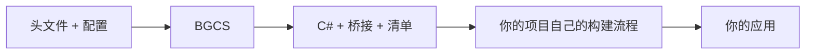

<h1 align="center">BindGen-CS</h1>
<p align="center">从 C/C++ 原生库，到 C# API。</p>
<p align="center">
  <a href="https://www.nuget.org/packages/BGCS"></a>
  <a href="https://github.com/FLwolfy/BindGen-CS/actions/workflows/ci.yml"></a>
  <a href="LICENSE"></a>
</p>
<p align="center">
  <a href="README.md">English</a> · <a href="#快速开始">快速开始</a> · <a href="#在-c-中生成绑定">C# 调用</a> · <a href="docs/README.cn.md">完整文档</a>
</p>

**BGCS 根据 C/C++ 头文件生成 C# 绑定。** 输出包括 C# 源码、按需生成的 C ABI 桥接源码、
文件清单和诊断。你可以使用命令行，也可以从自己的 C# 工具中调用。



BGCS 负责解析、分析和生成。你的项目负责编译、链接、包装和部署。

## 功能

| 方面 | 能力 |
| --- | --- |
| 解析 | 基于 Clang 读取 C/C++ 声明、类型、宏、注释、布局和模板。 |
| C++ 桥接 | 支持范围内的构造、成员、继承、模板实例、异常边界，以及 `std::string`、`std::vector`、`std::optional` 等类型转换。 |
| C# 输出 | FunctionTable、DllImport、LibraryImport；原始与友好 API；实例或静态 API；分文件或单文件。 |
| Runtime | 模块加载、handle、内存、UTF-8/16/32 和回调生命周期；可引用包或生成源码。 |
| 定制 | 命名、筛选、类型映射、语义、插件、自定义目标；缓存跟踪输入变化，支持工作区。 |

**基线为 .NET 10 / C# 14。** 默认 C17 或 C++23、实例 API、FunctionTable、分文件和包形式 Runtime。
FunctionTable 会在开始调用前，把所需原生导出解析到当前 API 实例的函数表中。

## 快速开始

### 1. 安装与配置

安装 [.NET 10 SDK](https://dotnet.microsoft.com/download/dotnet/10.0)，然后执行：

```bash
dotnet tool install --global BindGen-CS --version 3.0.0
```

假设你的原生库导出了 `native.h` 中的函数：

```c
int bgcs_add(int left, int right);
```

在头文件旁保存 `bindgen.json`：

```json
{
  "schemaVersion": 1,
  "library": { "id": "quickstart", "nativeName": "quickstart" },
  "source": { "language": "c", "headers": ["native.h"] },
  "api": {
    "namespace": "QuickStart.Generated",
    "name": "NativeApi",
    "names": { "bgcs_add": "Add" }
  },
  "output": { "root": "Generated", "layout": "split" }
}
```

相对路径以配置文件为基准，默认选择当前宿主目标。为自己的头文件创建配置时，
也可以运行 `bindgen-cs init native.h --language c`，自动生成起始配置和 schema。

### 2. 生成

```bash
bindgen-cs generate bindgen.json
```

把 `Generated/<target>/managed/` 下的 C# 文件加入 .NET 项目，例如复制到项目内的
`Generated/` 目录。这个简单 C API 不需要桥接源码。

<details>
<summary>查看输出布局与常用命令</summary>

```text
Generated/
├─ generation.report.json
└─ <target>/
   ├─ managed/       # C# 源码
   ├─ native/        # 按需生成的桥接头文件与源码
   └─ metadata/      # 文件清单、ABI 与绑定元数据
```

```bash
bindgen-cs doctor bindgen.json
bindgen-cs validate bindgen.json
bindgen-cs inspect bindgen.json --json
bindgen-cs diff bindgen.json
bindgen-cs workspace generate workspace.json
```

将 `runtime.mode` 设为 `"source"`，可生成 Runtime 源码并省去 Runtime 包引用；
将 `output.layout` 设为 `"singleFile"`，可合并输出为 `Bindings.cs`。

</details>

### 3. 在应用中调用

在消费项目现有 `.csproj` 的 `<Project>` 节点内加入：

```xml
<PropertyGroup>
  <TargetFramework>net10.0</TargetFramework>
  <AllowUnsafeBlocks>true</AllowUnsafeBlocks>
</PropertyGroup>
<ItemGroup>
  <PackageReference Include="BGCS.Runtime" Version="3.0.0" />
</ItemGroup>
```

原生库编译完成后，把其完整路径作为应用的第一个参数：

```csharp
using System;
using QuickStart.Generated;

using NativeApi api = NativeApi.Load(args[0]);
Console.WriteLine(api.Add(19, 23)); // 42
```

```bash
dotnet run -- "/absolute/path/to/native-library"
```

原生文件通常是 `quickstart.dll`、`libquickstart.so` 或 `libquickstart.dylib`。
原始入口为 `api.Raw.Add(19, 23)`。
[可运行的 QuickStart](examples/QuickStart/README.md) 包含原生源码与独立的 CMake 构建示例。

## C++ 绑定

在你的 C++ 库目录中执行：

```bash
bindgen-cs init include/widget.hpp --language cpp
bindgen-cs generate bindgen.json
```

对于支持的 C++ 操作，BGCS 还会输出 `native/include/` 和 `native/src/`，把 C++ 操作转换为
C# 可以调用的 C 风格入口。桥接源码由原生项目编译、链接；生成的 C# 由 .NET 项目编译。
只需要桥接源码时使用 `bridge`。

模板需要选择具体实例；所有权、编码、长期回调等语义按需补充。自定义类型可以通过插件、
recipe 或原生 shim 处理。参阅 [C++ 手册](docs/cpp-extension-cookbook.cn.md)与[类型转换](docs/lowering.cn.md)。

## 在 C# 中生成绑定

在自己的 C# 工具项目中引用生成库：

```bash
dotnet add package BGCS --version 3.0.0
```

```csharp
using System;
using BGCS;

await using BindingHost host = BindingHost.CreateDefault();
GenerationResult result = await host.GenerateAsync(
    GenerationRequest.FromFile("bindgen.json"));

if (!result.success)
    throw new InvalidOperationException(result.GetDiagnosticSummary());
```

这个普通生成类库就是 **BGCS SDK**。`BindingHost` 是流程协调对象，与命令行使用同一套生成
实现。完整包自带匹配的解析资源，首次使用时在本地准备隔离运行的 Clang worker 子进程。

| 产品 | 使用者 |
| --- | --- |
| [`BindGen-CS`](https://www.nuget.org/packages/BindGen-CS) | 终端命令与脚本。 |
| [`BGCS`](https://www.nuget.org/packages/BGCS) | 你自己的 C# 生成工具。 |
| [`BGCS.Runtime`](https://www.nuget.org/packages/BGCS.Runtime) | 使用绑定的应用，也可以改用生成的 Runtime 源码。 |
| [`BGCS.Contracts`](https://www.nuget.org/packages/BGCS.Contracts) | 标准生成插件。 |

应用需要生成的 C#、Runtime 支持和原生库。生成器与解析器属于生成工具这一侧。

## 平台与扩展

- **宿主：** 根据本机系统和进程架构选择解析器资源。
- **目标：** 根据配置选择原生类型布局和调用规则，也就是 ABI。
- **目标 SDK：** 由你提供对应头文件、sysroot、宏和标准库环境。

例如，Windows x64 可以使用 Windows 解析器和 Android NDK 头文件生成 Android ARM64 绑定，
再由你的 Android 项目编译和链接。

工具提供 Windows、GNU Linux、macOS 的 x64/ARM64 宿主资源；自动化真实调用验证运行在桌面
x64。资源可用、能够识别目标，与完成所有 Runtime/ABI 组合认证是不同状态，见[能力说明](docs/capabilities.cn.md)。

命名、筛选和语义优先使用配置。标准插件引用 `BGCS.Contracts`，操作中立模型。
私有目标插件可以接入特殊 SDK；新的调用 ABI 或托管运行机制仍需相应实现。
参阅[插件](docs/extensibility.cn.md)与[平台扩展](docs/platform-extension.cn.md)。

## 文档

| 开始使用 | 定制行为 | 了解实现 |
| --- | --- | --- |
| [快速开始](docs/getting-started.cn.md) | [配置](docs/configuration-guide.cn.md) | [架构](docs/architecture.cn.md) |
| [C# API](docs/api.cn.md) | [C++ 手册](docs/cpp-extension-cookbook.cn.md) | [ABI 安全](docs/abi-safety.cn.md) |
| [包的选择](docs/packages.cn.md) | [源码处理](docs/source-processing.cn.md) | [Runtime 生命周期](docs/runtime-lifetime.cn.md) |

**示例：** [QuickStart](examples/QuickStart/README.md) · [NativeShim](examples/NativeShim/README.md) ·
[LoweringPlugin](examples/LoweringPlugin/README.md) · [CustomTargetPlugin](examples/CustomTargetPlugin/README.md) ·
[CustomAllocator](examples/CustomAllocator/README.md) · [CustomFunctionTable](examples/CustomFunctionTable/README.cn.md)。

[完整文档](docs/README.cn.md) · [参与开发](CONTRIBUTING.md) · [测试](docs/testing.cn.md)

[可迁移原生源码清单与消费者输入映射](docs/native-source-inputs.cn.md)。

## 许可证

[MIT](LICENSE)。第三方版权与许可全文保留在 [THIRD-PARTY-NOTICES](THIRD-PARTY-NOTICES.md)
和分发的资源声明中。
