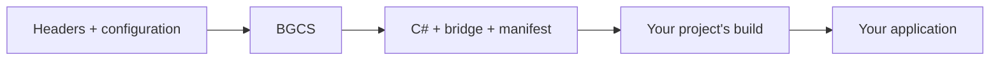

<h1 align="center">BindGen-CS</h1>
<p align="center">C and C++ libraries. C# APIs.</p>
<p align="center">
  <a href="https://www.nuget.org/packages/BGCS"></a>
  <a href="https://github.com/FLwolfy/BindGen-CS/actions/workflows/ci.yml"></a>
  <a href="LICENSE"></a>
</p>
<p align="center">
  <a href="README.cn.md">简体中文</a> · <a href="#quick-start">Quick start</a> · <a href="#generate-from-c">C# library</a> · <a href="docs/README.md">Documentation</a>
</p>

**BGCS generates C# bindings from C/C++ headers.** It produces C# source, any
required C ABI bridge source, file manifests and diagnostics. Use the CLI or call
the generator from your own C# tool.



BGCS owns parsing, analysis and generation. Your project owns compilation, linking,
packaging and deployment.

## Features

| Area | Capabilities |
| --- | --- |
| Parsing | Clang-based C/C++ declarations, types, macros, comments, layouts and templates. |
| C++ bridges | Supported constructors, methods, inheritance, template instances, exception boundaries and types such as `std::string`, `std::vector` and `std::optional`. |
| C# output | FunctionTable, DllImport or LibraryImport; raw and friendly APIs; instance or static APIs; split or single-file output. |
| Runtime | Module loading, handles, memory, UTF-8/16/32 and callback lifetimes; package or emitted source. |
| Customization | Naming, selection, type mapping, semantics, plugins, custom targets, input-aware caching and workspaces. |

**Requires .NET 10 / C# 14.** Defaults: C17 or C++23, instance API, FunctionTable,
split files and package Runtime. FunctionTable resolves the required native exports
into an API instance before calls begin.

## Quick start

### 1. Install and configure

Install the [.NET 10 SDK](https://dotnet.microsoft.com/download/dotnet/10.0), then:

```bash
dotnet tool install --global BindGen-CS --version 3.0.0
```

Suppose your native library exports this function in `native.h`:

```c
int bgcs_add(int left, int right);
```

Save `bindgen.json` beside the header:

```json
{
  "schemaVersion": 1,
  "library": { "id": "quickstart", "nativeName": "quickstart" },
  "source": { "language": "c", "headers": ["native.h"] },
  "api": {
    "namespace": "QuickStart.Generated",
    "name": "NativeApi",
    "names": { "bgcs_add": "Add" }
  },
  "output": { "root": "Generated", "layout": "split" }
}
```

Paths are relative to this configuration. The default target is the current host.
For your own header, `bindgen-cs init native.h --language c` creates a starter
configuration and schema.

### 2. Generate

```bash
bindgen-cs generate bindgen.json
```

Add `Generated/<target>/managed/` C# files to your .NET project, for example by
copying them into its `Generated/` folder. This simple C API needs no bridge.

<details>
<summary>Output layout and useful commands</summary>

```text
Generated/
├─ generation.report.json
└─ <target>/
   ├─ managed/       # C# source
   ├─ native/        # Bridge headers/sources, when needed
   └─ metadata/      # File manifest, ABI and binding metadata
```

```bash
bindgen-cs doctor bindgen.json
bindgen-cs validate bindgen.json
bindgen-cs inspect bindgen.json --json
bindgen-cs diff bindgen.json
bindgen-cs workspace generate workspace.json
```

Set `runtime.mode` to `"source"` to emit Runtime source instead of referencing its
package. Set `output.layout` to `"singleFile"` for a single `Bindings.cs`.

</details>

### 3. Call from your application

Inside your consumer's existing `.csproj` `<Project>` element, add:

```xml
<PropertyGroup>
  <TargetFramework>net10.0</TargetFramework>
  <AllowUnsafeBlocks>true</AllowUnsafeBlocks>
</PropertyGroup>
<ItemGroup>
  <PackageReference Include="BGCS.Runtime" Version="3.0.0" />
</ItemGroup>
```

Once your native library is built, use its full path as the first application argument:

```csharp
using System;
using QuickStart.Generated;

using NativeApi api = NativeApi.Load(args[0]);
Console.WriteLine(api.Add(19, 23)); // 42
```

```bash
dotnet run -- "/absolute/path/to/native-library"
```

The native file is typically `quickstart.dll`, `libquickstart.so` or
`libquickstart.dylib`. Use `api.Raw.Add(19, 23)` for the raw entry.
The [runnable QuickStart](examples/QuickStart/README.md) includes native source
and an external CMake build.

## C++ bindings

In your C++ library's directory:

```bash
bindgen-cs init include/widget.hpp --language cpp
bindgen-cs generate bindgen.json
```

For supported C++ operations, BGCS also emits `native/include/` and `native/src/`.
This bridge exposes C++ operations through C-callable entry points. Compile and link
it in your native project; compile the generated C# in your .NET project.
Use `bridge` to request only bridge sources.

Select concrete template instances and declare ownership, encoding or retained
callback semantics where needed. Custom types can use plugins, recipes or native
shims. See the [C++ cookbook](docs/cpp-extension-cookbook.md) and [lowerings](docs/lowering.md).

## Generate from C#

Reference the generator in your own C# tool:

```bash
dotnet add package BGCS --version 3.0.0
```

```csharp
using System;
using BGCS;

await using BindingHost host = BindingHost.CreateDefault();
GenerationResult result = await host.GenerateAsync(
    GenerationRequest.FromFile("bindgen.json"));

if (!result.success)
    throw new InvalidOperationException(result.GetDiagnosticSummary());
```

This ordinary generation library is the **BGCS SDK**. `BindingHost` coordinates
generation, using the same pipeline as the CLI. The complete package ships matching
parser resources and prepares its isolated Clang worker locally on first use.

| Package | Used by |
| --- | --- |
| [`BindGen-CS`](https://www.nuget.org/packages/BindGen-CS) | Terminal commands and scripts. |
| [`BGCS`](https://www.nuget.org/packages/BGCS) | Your C# generation tool. |
| [`BGCS.Runtime`](https://www.nuget.org/packages/BGCS.Runtime) | Applications using generated bindings; emitted Runtime source is an alternative. |
| [`BGCS.Contracts`](https://www.nuget.org/packages/BGCS.Contracts) | Standard generation plugins. |

The application needs generated C#, Runtime support and its native library.
The generator and parser stay with the generation tool.

## Platforms and extension

- **Host:** the local OS and process architecture select the parser resources.
- **Target:** the configuration selects the native layout and calling rules (ABI).
- **Target SDK:** your supplied headers, sysroot, macros and standard library describe that environment.

For example, Windows x64 can generate Android ARM64 bindings using its Windows
parser and Android NDK headers. Your Android project compiles and links the result.

Tools ship x64/ARM64 host resources for Windows, GNU Linux and macOS. Automated
native-call checks run on desktop x64; resource availability and target recognition
do not certify every runtime/ABI combination. See [capabilities](docs/capabilities.md).

Start with configuration for naming, selection and semantics. Standard plugins
reference `BGCS.Contracts` and work with neutral models. A private target plugin
can supply a custom SDK; a new calling ABI or managed runtime requires its own
implementation. See [plugins](docs/extensibility.md) and [platform extension](docs/platform-extension.cn.md).

## Documentation

| Start | Customize | Understand |
| --- | --- | --- |
| [Getting started](docs/getting-started.md) | [Configuration](docs/configuration-guide.md) | [Architecture](docs/architecture.md) |
| [C# API](docs/api.md) | [C++ cookbook](docs/cpp-extension-cookbook.md) | [ABI safety](docs/abi-safety.md) |
| [Packages](docs/packages.md) | [Source processing](docs/source-processing.md) | [Runtime lifetimes](docs/runtime-lifetime.md) |

**Examples:** [QuickStart](examples/QuickStart/README.md) · [NativeShim](examples/NativeShim/README.md) ·
[LoweringPlugin](examples/LoweringPlugin/README.md) · [CustomTargetPlugin](examples/CustomTargetPlugin/README.md) ·
[CustomAllocator](examples/CustomAllocator/README.md) · [CustomFunctionTable](examples/CustomFunctionTable/README.md).

[All documentation](docs/README.md) · [Contributing](CONTRIBUTING.md) · [Testing](docs/testing.md)

[Portable native source manifests and consumer input mapping](docs/native-source-inputs.md).

## License

[MIT](LICENSE). Third-party copyright and license texts are retained in
[THIRD-PARTY-NOTICES](THIRD-PARTY-NOTICES.md) and the distributed resource notices.
