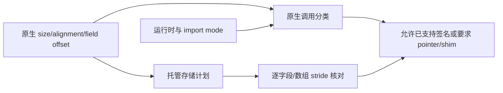

# ABI 安全与语义证据

[文档](README.cn.md) · [English](abi-safety.md) · [Runtime 生命周期](runtime-lifetime.cn.md)

BGCS 保留原生类型事实，直到最终 C ABI 与托管生成计划通过验证。熟悉的类型名、C# 编译成功或相同总大小都不证明调用安全；未知事实保持未知。

## 存储与调用分别证明

分别验证原生存储、托管载体存储和按值调用 ABI。ExplicitLayout 能表示 offset，不会自动修复寄存器分类、栈对齐或运行时 marshalling。

默认 `bridge.aggregateStrategy = pointerBridge` 将跨边界 aggregate 改为类型化指针和输出参数；原生桥内部执行原始按值调用。显式 `direct` 仍须取得精确调用计划。

当前 C# 规划允许支持的 primitive、enum、pointer 和固定 callback ABI。已解析的 .NET 10 CoreCLR/NativeAOT 聚合 profile 还可以采用 Windows x64 或 System V AMD64 的已实现调用算法；这个机制描述不等于平台认证收据。

规划递归核对标量载体、数组 stride、完整字段、重叠规则、size 与托管 alignment。可表示时 explicit layout 采用匹配的 packing；生成的外层 alignment probe 在创建上下文时检查实际托管字段位置。ABI manifest 记录 runtime profile、storage packing 和调用分类。

Windows x64 的普通小聚合按大小分类；System V AMD64 还根据真实浮点/整数成员进行 eightbyte 分类，未对齐字段或较大的记录使用 memory 形式。不能只根据 `sizeof` 推出调用兼容；见 [Microsoft x64 ABI](https://learn.microsoft.com/en-us/cpp/build/x64-calling-convention?view=msvc-170) 与 [.NET 10 分类实现](https://github.com/dotnet/runtime/blob/v10.0.0/src/coreclr/vm/methodtablebuilder.cpp)。

未知 profile、无法匹配的 alignment、位字段、柔性数组、空/不完整记录与特殊标量仍要求 pointer 或 native bridge。Browser 的 managed/native 边界只允许其已实现的标量/地址载体，aggregate 通过桥接转换；未实现的直接聚合 ABI 不会自动开放。其他 CPU 同样需要适用的调用计划。测试必须真实执行参数、返回值和反向回调，并覆盖 import mode 与托管执行模型，不能以编译成功代替。

嵌套过度对齐回归分别验证 `Outer.size = 96`、`Outer.nested = 32`、`Outer.suffix = 64`。总大小正确但字段错误仍是错误。普通托管分配不承诺任意原生对齐；需要时使用配对 aligned allocator，并核对每个指针的对齐。

## 事实与证据

| 证据 | 含义 |
| --- | --- |
| Unknown | 缺失信息。 |
| Inferred | 规则或启发式推断。 |
| Declared | 结构化原生输入声明。 |
| UserAsserted | 用户明确声明。 |
| Verified | 规定的独立验证建立事实。 |

证据保存来源。用户信任配置不把声明提升为 Verified。Create/Destroy 名称不验证 allocator，enum 名称不验证宽度。

模型保留稳定 ID、alias 身份和底层类型、逐层指针 qualifier、数组维度、enum carrier、字段/位 offset、调用约定、目标字节序和来源。变换必须保留 ABI 身份，或采用明确支持的 bridge operation。

## 基础类型与特殊 scalar

`char` 符号性、`long`、`size_t`、指针、bool、enum 底层类型和 `wchar_t` 来自实际目标。Windows LLP64 不等于 Linux LP64，wasm32 指针不等于生成器宿主指针。

`long double`、half/BFloat16、128-bit scalar 或 `va_list` 的存储表示不意味着支持按值调用。16 字节托管载体不能证明 SysV x87 `long double` 传参/返回安全。shim 可使用指针/字节或明确转换，但不能静默替换成 `double` 丢失语义。

原生固定宽度 enum 和 `api.enums` 保留完整 signed/unsigned 范围。`api.enumMappings` 通过宽度与符号核对后改变 friendly 展示，raw 标量 ABI 不变。成员使用十进制字符串，避免 JSON 浮点丢失 UInt64 高位和最大值。

## 文本语义

`char*` 不自动表示 UTF-8。`StringContract` 描述编码、code-unit 宽度/字节序、长度单位、方向、null/零终止、保留地址、lifetime，以及需要时的所有权/释放。

两字节 `wchar_t` 可采用明确 UTF-16 契约，四字节需要 UTF-32。`"AB"` 的 UTF-32 首个 code point 是 65，不能把两个 UTF-16 合并成 4325441。补充平面字符、严格非法 Unicode 处理、终止符与原生长度单位需分别验证。

临时输入字符串投影要求 read-only、明确不保留地址的同步调用 lifetime，以及明确的 null 策略。支持无长度通道的零终止输入，或明确不带终止符、具有一个独立普通整数输入长度参数的计数输入。计数路径在原生调用前核对编码宽度、字节序、字节／code-unit 长度单位、正值 code-unit 上限及原生整数范围。共享计数、固定长度、保留地址／异步文本和相互冲突的地址协议需要另行支持的 projection/shim；可表达的 raw ABI 仍然保留。

## Buffer、所有权、callback 与 async

Buffer 契约描述 element、bounds/length 单位、direction、保留地址、null 和 required alignment。Pinned Span 转换要求支持的固定 element 存储、同步 call lifetime 和精确 length 参数。不能假定独立 capacity 协议或 flexible tail 是普通 Span。

Owned result 要有匹配的 release function/domain 和 lifetime。非零借用指针不会自动获得析构责任。Callback unregister 必须禁止新调用并同步原生使用；取消不允许在 native terminal 确认前释放 pin。Runtime 帮助实现明确协议，不代表自动生成全部 callback/async 投影。见 [Runtime 生命周期](runtime-lifetime.cn.md)。

缺少语义不虚构 friendly wrapper；可表达的 raw ABI 仍有用。明确请求的不安全或不可表达投影会失败，不能悄悄改变契约。

## 数组、union、位字段与 varargs

完整、受支持的固定 callback prototype 使用精确函数指针。可变参数、未声明参数列表或无法证明托管调用形式的 callback 可以作为 `nint` 保存、传递和返回；原始 prototype 与不能直接调用的原因保留在 ABI metadata 的 `opaqueCallbackAddresses`。这条路径只借用地址，不把未知或可变签名伪装成固定调用。需要从 C# 调用它时，必须提供原生固定签名 adapter。普通可变参数导出仍要求固定 wrapper；不会因此获得任意 vararg 调用能力。

维度、固定 stride 和 incomplete/flexible tail 保持明确。Union 重叠与每个 offset 匹配原生事实。位字段使用精确 bit offset、width 和符号扩展；当前 backend 访问要求已证明 little-endian。未知或大端需要原生 adapter。

可变参数和无明确 prototype 的调用要求固定签名 native wrapper。FunctionTable 不提供任意 varargs；存在 `va_list` 载体不等于通用可移植调用实现。

## 桥接源码与独立消费者验证

类型化 operation 表达构造、析构、原生 cast、参数/返回转换和异常边界。多继承使用原生 cast；C++ 异常在 C status/error 边界停止，清理保留明确的 allocator 所有权。

BGCS 重新解析生成的 C header，核对导出签名，并按稳定身份合并 ownership/error/lifetime 语义。
需要的存储与调用签名断言作为源码输出，由消费者编译。生成阶段不调用编译器 driver、GCC/MSVC 预处理、对象编译或托管消费者测量程序。
事实描述明确配置的 Clang 解析环境，下游构建必须保持头文件、宏、packing 和 ABI 相容。仓库的独立消费 fixture 自行编译并真实调用生成结果，以验证这些假设。

不支持的输入与缺少可靠按值 ABI 依据的签名明确拒绝。静态字段绑定只证明 scalar copy 的类型相容，不证明 CLR 实测布局或原生调用等价。
需要时使用合适的 frontend、pointer 或原生 shim；生成器不运行编译器兼容重写，也不猜测同大小类型替代。

## Import 与最终源码

FunctionTable、DllImport 和 LibraryImport 共享 interop/语义模型，但各自运行时签名能力不同。FunctionTable 必需导出完整验证。外部 ABI 字符串属于声明，不是独立调用证明。

Processor 在最终源码契约验证前运行，缓存命中也复核实际 import 签名、layout 和 convention strategy。能编译的 rewrite 不能暗改冻结 ABI。

浏览器 wasm32 使用类型化静态模块能力。只有已验证 browser static profile 的 Cdecl LibraryImport 可省略冗余显式 convention metadata；不同约定或 profile 改动被拒绝。其他 import 保留显式策略。该有限选择由同一真实浏览器 AOT fixture 验证，不修改生成输出绕过测试。

## 验收证据

独立 NativeAOT、浏览器解释/AOT fixture 保留三种 import 的全部 74 项检查，包括 scalar、UInt64 高位 enum、原生 long/bool、layout/bitfield 指针、bounds/capacity、ref/ref、in/out、记录字段与 Span/ref 的原地址别名、handle、callback/null/release、生成托管 callback 的状态捕获与原始异常返回、C++ 对象/继承，以及不完整/借用/缺失导出函数表。失败注入改变原生返回结果，必须在真实调用失败，不能仅因无关构建失败而通过。

可选私有 NativeAOT fixture 另外保留 39 项 aggregate 检查，合计 113 项。三种 import 都调用 C17 中的小型、混合、大型、union、嵌套、同类浮点、内联数组、紧密未对齐和单浮点成员记录的变换，包括按值记录的反向回调。每种 import 的结果签名必须与独立编译的原生 C probe 相同。这是私有应用证据，不是强制桌面发布门禁；浏览器 aggregate 能力仍单独界定。

收据记录 source revision/dirty 状态、真实 generator/Runtime/worker 字节、目标、运行时、编译器/SDK/workload 和检查项。本机 Windows 不能认证 Linux、macOS、所有 ABI 特性或安装产品。支持声明和同 revision 发布门禁以[测试](testing.cn.md)、[实施状态](implementation-status.cn.md)和[功能 inventory](../eng/acceptance/feature-inventory.json)为依据。
