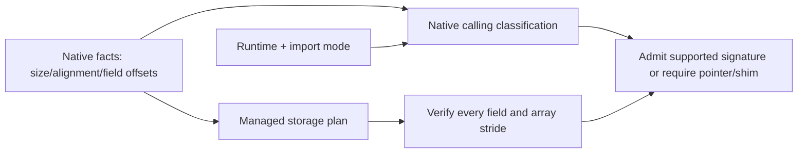

# ABI safety and semantic evidence

[Documentation](README.md) · [简体中文](abi-safety.cn.md) · [Runtime lifetimes](runtime-lifetime.md)

BGCS preserves native type facts until the final C ABI and managed emission
plan are validated. A familiar type name, successful C# compile or equal total
size cannot prove safe native invocation. Unknown facts remain unknown.

## Storage and calling compatibility are separate

Verify native storage, managed carrier storage and by-value calling ABI
independently. ExplicitLayout can represent offsets but does not fix parameter
register classification, stack alignment or runtime marshalling.

Current C# planning admits supported primitive, enum, pointer and fixed callback
ABI signatures. A resolved .NET 10 CoreCLR/NativeAOT aggregate profile also admits
representable C structs/unions for the implemented Windows x64 and System V AMD64
algorithms. This is distinct from a platform certification receipt.

Aggregate planning recursively checks scalar carriers, array stride, complete
fields, overlap rules, size and managed alignment. Explicit layout uses matched
packing when representable; a generated enclosing alignment probe checks managed
field placement at context creation. The ABI manifest records the runtime profile,
storage packing and argument/return classification.

Windows x64 classifies small ordinary aggregates by size. System V additionally
classifies actual floating/integer fields into eightbytes and uses memory for
unaligned fields or larger aggregates. These are separate runtime algorithms,
not conclusions drawn only from `sizeof`. See the [Microsoft x64 ABI](https://learn.microsoft.com/en-us/cpp/build/x64-calling-convention?view=msvc-170)
and [.NET 10 runtime classification implementation](https://github.com/dotnet/runtime/blob/v10.0.0/src/coreclr/vm/methodtablebuilder.cpp).

Unknown profiles, unrepresentable alignment, bitfields, flexible arrays, empty or
incomplete records and special scalars still require a pointer or native bridge.
Browser and other CPU aggregate profiles remain unsupported until their calling
path is implemented and validated. Every import mode and execution model needs
real argument, return and reverse callback tests; compilation is insufficient.

The over-aligned nested regression checks three independent native facts:
`Outer.size = 96`, `Outer.nested = 32`, `Outer.suffix = 64`.
Correct total size with wrong field offsets is still wrong. Ordinary managed
allocation cannot promise arbitrary native alignment; use the matched aligned
allocator where required and validate each pointer's alignment.

## Facts and evidence

| Evidence | Meaning |
| --- | --- |
| Unknown | Required information is absent. |
| Inferred | A rule or heuristic guessed it. |
| Declared | Structured native input declares it. |
| UserAsserted | The user explicitly states it. |
| Verified | An independent specified verification establishes it. |

Each evidence record retains its origin. Configuration assertions do not become
Verified merely because the user trusts them. A Create/Destroy name cannot
verify allocator compatibility; an enum name cannot verify its width.

Models preserve stable IDs, alias identity and underlying types, each pointer's
qualifiers, arrays/dimensions, native enum carriers, field/bit offsets,
calling conventions, target byte order and origin. Transforms must preserve
ABI identity unless using an explicit supported bridge operation.

## Target-specific primitive facts

Resolve `char` signedness, `long`, `size_t`, pointers, bool, enum underlying
types and `wchar_t` from the actual target. Windows LLP64 is not Linux LP64;
wasm32 pointers are not the host generator's pointers.

Special storage such as `long double`, half/BFloat16, 128-bit scalars and
`va_list` does not imply admitted by-value calls. In particular, a 16-byte
managed carrier cannot prove SysV x87 `long double` parameter/return safety.
An explicit shim can operate on pointers/bytes or perform declared conversion;
silently replacing native `long double` with `double` loses semantics.

Native fixed-width enums and configured `api.enums` retain complete signed/
unsigned ranges. `api.enumMappings` changes friendly presentation only after
width/signedness validation; raw scalar ABI stays unchanged. Decimal member
values prevent JSON floating-point loss for high UInt64 bits and maximum values.

## Text semantics

`char*` is not automatically UTF-8. `StringContract` describes encoding,
code-unit width, byte order, length unit, direction, null/zero termination,
address retention, lifetime and ownership/release where needed.

Two-byte `wchar_t` can use an explicit UTF-16 contract; four-byte `wchar_t`
requires UTF-32. Encoding `"AB"` as UTF-32 begins with code point 65, not the
combined UTF-16 bit pattern 4325441. Supplementary scalars, strict invalid
Unicode handling, terminators and native code-unit lengths are checked
separately.

Friendly temporary string inputs require a read-only, explicitly nonretaining
synchronous call lifetime and an explicit null policy. They support either zero
termination without a length channel, or explicitly nonterminated counted input
with one independent plain integer input-length parameter. The counted route
checks encoding width and byte order, byte/code-unit length units, a positive
code-unit bound and the native integer range before invocation. Shared counts,
fixed-length inputs, retained/asynchronous text and competing address protocols
require a separately supported projection/shim; eligible raw ABI remains available.

## Buffers, ownership, callbacks and async

A buffer contract identifies element type, bounds/length units, direction,
retention, null allowance and required alignment. A pinned Span conversion
requires supported fixed element storage, synchronous call lifetime and an
exact length parameter. The current projection does not assume independent
capacity protocols or flexible tails are normal spans.

Owned results require a matching release function/domain and lifetime.
Borrowed resources cannot gain destruction responsibility merely because their
pointer is nonzero. Callback unregister must prevent new starts and drain native
use. Cancellation must not release pinned resources before native terminal
acknowledgement. Runtime helpers support these explicit protocols; their
presence is not evidence of complete automatic callback/async projection.
See [Runtime lifetimes](runtime-lifetime.md).

No friendly wrapper is fabricated from missing semantics. Eligible raw ABI
remains useful where representable. An explicitly requested unsafe or
unrepresentable projection fails rather than silently changing its contract.

## Arrays, unions, bitfields and variadics

Array dimensions, fixed strides and incomplete/flexible tails remain explicit.
Union overlap and each field offset must match native facts. Bitfield access
uses exact bit positions, widths and signed extension; current backend access
requires proven little-endian layout. Unknown/big-endian bitfield cases require
a native adapter rather than host-endian assumptions.

Variadic and unspecified-prototype calls require fixed-signature native
wrappers. FunctionTable does not provide arbitrary varargs. A storage carrier
for `va_list` is not a portable general calling implementation.

## Bridge source and independent consumer verification

Typed bridge operations express construction, destruction, native casts, conversions
and exception boundaries. Multiple inheritance uses a native cast. C++ exceptions
stop at the C status/error boundary with explicit allocator cleanup.

BGCS reparses the generated C header and checks export signatures, then merges
ownership/error/lifetime semantics by stable identity. Optional storage and callable
assertions are emitted as source for the consumer to compile. Generation does not
run compiler drivers, preprocess with GCC/MSVC, compile objects or measure a managed
consumer. Its facts describe the declared Clang parse environment. Downstream builds
must keep that environment and ABI compatible; independent repository fixtures
compile and invoke generated bindings to test those assumptions.

Unsupported input or an unproved by-value calling ABI is rejected. Static field
binding establishes scalar-copy compatibility only, never measured CLR layout or
native calling equivalence. Use an explicit frontend or pointer/native shim where
required; no compiler-compatibility rewrite or guessed same-size replacement runs.

## Import modes and final source checks

FunctionTable, DllImport and LibraryImport share one interop/semantic model,
but their supported runtime signatures differ. Required function-table symbols
are validated as a complete set. External ABI identity strings are assertions,
not independent calling proofs.

Generated source processors run before final emitted-contract verification.
The actual import signatures, layouts and convention strategy are checked
against the frozen plan, including after a cache hit. A successfully compiling
processor rewrite cannot silently alter the native contract.

Browser wasm32 has a typed static module capability. LibraryImport can omit
redundant explicit Cdecl metadata only for its validated browser static profile;
different conventions or profile changes are rejected. Other import paths
retain their explicit convention strategy. This bounded choice is covered by
the same actual browser AOT fixture, not a generated-output patch.

## Callback addresses with unsupported invocation signatures

Complete supported fixed callback prototypes use exact unmanaged function
pointers. A variadic, unspecified or otherwise unsupported managed invocation
prototype can still be stored, passed or returned as an opaque `nint` address.
The original native prototype and invocation restriction remain in ABI
metadata under `opaqueCallbackAddresses`. This borrows an address and does not
invent a fixed callable signature. Calling such an address from C# requires a
native adapter with a supported fixed prototype. Ordinary variadic native
exports still require fixed wrappers.

## Acceptance evidence

Independent NativeAOT and browser interpreter/AOT fixtures share 74 checks
across all three imports: scalars, high UInt64 enum bits, native long/bool,
layout/bitfield pointers, bounds/capacity, original-address ref/ref, in/out,
record-field and Span/ref aliases, handles, callbacks/nulls/releases,
generated managed callback capture and original-exception propagation,
C++ objects/inheritance and incomplete/borrowed/missing-symbol tables.
Negative injection changes a native result and must fail actual invocation,
not merely fail an unrelated build.

The optional private NativeAOT fixture additionally has 39 aggregate checks, for 113 in total.
All three imports call C17 transformations of small, mixed, large, union,
nested, homogeneous floating-point, inline-array, packed and singleton
aggregates, including aggregate reverse callbacks. Each import's result
signature must match a separately compiled native C probe. This is private application evidence, not a mandatory
desktop release gate; browser aggregate support remains a separate capability.

A receipt names source revision/dirty status, real generator/Runtime/worker
bytes, target, runtime, compiler/SDK/workload and completed checks. Local
Windows receipts do not certify Linux, macOS, every ABI feature or installed
products. [Testing](testing.md), [implementation status](implementation-status.cn.md)
and [feature inventory](../eng/acceptance/feature-inventory.json) remain the
basis for specific support claims and same-revision release gates.
