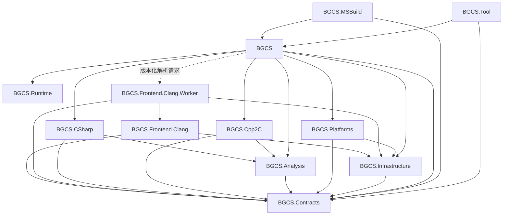
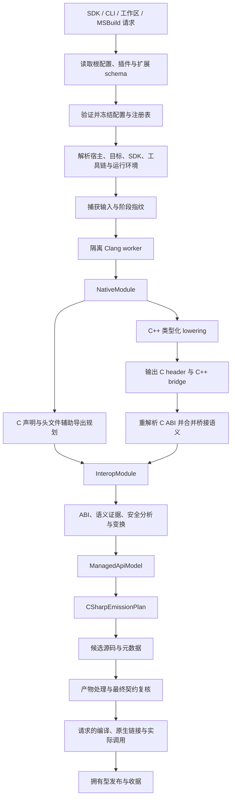
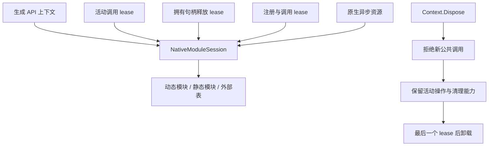

# BGCS 3.0 架构

[English](architecture.md) | [文档索引](README.cn.md) | [实施状态](implementation-status.cn.md)

3.0 的公开入口是 `BindingHost`，使用分组配置与中立模型流水线。本文定义发布必须满足的边界，并解释新的主要实现，不等于验收通过收据。完成状态由[工程依赖规则](../eng/architecture/project-dependencies.json)、[功能清单](../eng/acceptance/feature-inventory.json)、真实测试收据与同 revision 的 CI 决定。旧公开生成器或禁止的工程引用仍然存在时，即使新 Host 路径可用，也不能关闭架构重构。

## 十三个实现工程与四个产品

工程边界负责源码归属；产品包负责交付。普通用户安装完整 `BGCS` SDK 或 `BindGen-CS` 工具，插件作者可以只引用 `BGCS.Contracts`，生成代码的消费者可以只引用 `BGCS.Runtime`。用户不需要手工拼装内部模块。

| 工程 | 主要职责 |
| --- | --- |
| `BGCS.Contracts` | 不可变原生/桥接/interop/托管模型、证据、诊断与扩展端口 |
| `BGCS.Infrastructure` | 文件、进程、序列化、worker 通信、插件加载、缓存与发布 |
| `BGCS.Frontend.Clang` | 从 Clang 提取声明、类型图、来源与布局事实 |
| `BGCS.Frontend.Clang.Worker` | 独立进程解析与版本化通信协议 |
| `BGCS.Platforms` | 解析宿主、目标、SDK、工具链、托管运行环境与资产能力 |
| `BGCS.Analysis` | 声明闭包、ABI/存储分析、语义证据与安全资格 |
| `BGCS.Cpp2C` | 规划 C++ lowering 与 C 头文件辅助导出，生成类型化桥接操作 |
| `BGCS.CSharp` | 托管 API 投影、导入/转换/清理规划与 C# 输出 |
| `BGCS.Runtime` | 独立消费者的模块会话、lease、句柄、缓冲区、编码与回调 |
| `BGCS` | 默认组合、配置、扩展、会话、工作区与公开 Host |
| `BGCS.Tool` | 将 CLI 参数与取消映射为 Host 请求，呈现结果 |
| `BGCS.MSBuild` | 显式启用的构建任务、解析资源部署与精确 manifest item 集成 |

发布要求的工程引用图如下。实线为工程引用，虚线为 worker 进程协议。

`Contracts` 与 `Runtime` 不依赖其他 BGCS 工程。普通 lowering 与托管 backend 不引用 Clang。Host 通过 worker 通信，不能把原生解析放进 SDK 应用进程。每份生产源码只有一个归属工程，不能用跨工程链接源码或可见性绕过替代契约。

## 五层模型与完整流水线

| 模型 | 内容 |
| --- | --- |
| `NativeModule` | 原生声明、精确类型/布局、模板、继承、来源与目标事实 |
| `CppBridgeModule` | 类型化原生操作、导出、转换、异常与生命周期协议 |
| `InteropModule` | 最终 C ABI，以及 ownership、allocator、字符串、buffer、callback 与错误契约 |
| `ManagedApiModel` | 托管类型、成员、公开投影与 Runtime 需求 |
| `CSharpEmissionPlan` | C# 导入、载体、布局、转换、固定、清理与文件决定 |

模型保留稳定 ID 和源码来源。未知事实保持未知；大小相同不能证明字段、对齐或调用约定一致。发布模型不保留 Clang cursor、原生句柄、可变配置或运行服务。

C++ 与 C 使用相同配置入口和 Host。C++ operation 表达构造、析构、调用、参数/结果转换、所有权、继承转换、回调和异常边界。C++ 异常在 C 边界转换。重新解析的 C 声明提供实际导出 ABI，再通过稳定导出身份合并 lowering 的生命周期语义。

C 的 inline/内部链接函数不自动成为动态导出。生成的辅助 header/source 必须编译进配置的原生模块，prebuilt 模式检查实际适配导出。Windows 的辅助 DLL 不会继承依赖 DLL 的其他导出；源码构建计划与独立原生 manifest 必须明确携带辅助输入。

`generate` 在模型、安全和源码契约检查后发布源码。消费者编译 C#，并通过外部系统构建、链接与部署原生库；生成成功不代表调用已经验证。

## 宿主、目标、SDK 与运行环境分离

运行 BGCS 的宿主决定解析 worker 与原生解析器资源；原生目标决定 CPU/OS/ABI；SDK/sysroot 提供头文件与库；原生 compiler/linker 完成构建；托管运行环境与 import mode 决定支持的调用机制。

例如 Windows x64 使用 `win-x64` 解析器，却可以用 Android NDK sysroot 生成 ARM64 声明。不能按输出目标选择解析器宿主资源。NuGet RID 也只是资产选择身份，不是完整 ABI；GNU 与 musl 不能共用误导性的资产路径。

默认使用 Clang，是为了利用成熟的 C/C++ 解析能力，不要求最终库也用 Clang 编译。实际编译器的预处理、头文件、布局与调用 ABI 仍然必须相容；无法在目标编译器复现的条件声明应验证失败，不能视为无差异。

嵌入的 Clang builtin headers 与系统 SDK/C/C++ headers 分开管理，[资源来源、hash 与许可证](../src/BGCS.Frontend.Clang/Resources/Clang/README.md)必须明确。其他 LLVM 安装不能静默替换解析资源。

浏览器 Wasm 使用静态模块/adapter、原生构建引用和适合 AOT 的回调机制。桌面动态加载是一种能力。Emscripten 与 WASI 是不同目标。新增平台家族应提供能力与工具链事实，不应让各 emitter 分散判断平台名称。

## ABI 与托管规划

原生存储布局、托管分配对齐和按值调用分类分别验证。过度对齐记录、特殊数值、packed aggregate、union 与 callback 都需要自己的证据。不支持的按值签名需要指针/native bridge；能保存某类型字节不等于能够按值调用它。

Raw API 提供可正确表达的 ABI。friendly string、Span、拥有型对象和异步 API 需要充分的生命周期、分配器、长度与编码证据。`char*` 不天然等于 UTF-8，`wchar_t` 来自目标事实。推断、声明、用户断言与独立验证是不同证据等级。

FunctionTable、DllImport 与 LibraryImport 使用同一份 interop 语义。先规划导入载体、公开类型、固定、分配、转换、错误与清理，再由 emitter 输出。默认实例上下文；显式静态 API 具有需要说明的共享模块生命周期。

## Runtime 生命周期

Context 关闭时，原生库仍可能被活动调用、析构、回调或异步任务使用。取消请求不等于 native 已停止访问 buffer。长期 callback 需要 unregister/结束协议，在自己的回调中关闭时不能等待自己而死锁。

Runtime 包独立于生成器与解析器依赖。源码模式使用版本化闭包并通过语法改写 namespace/引用，使多套库共存。package/source 与 split/single-file 都必须真实编译消费与调用。

## 扩展、配置、缓存与发布

普通插件只引用 `BGCS.Contracts`，注册类型化端口。SDK、CLI、工作区与 MSBuild 共用冻结注册表，服务具有稳定 ID、顺序、冲突规则和生命周期。Clang 专有事实扩展仅在 worker 中执行；普通 lowering 使用中立模型。参见[扩展指南](extensibility.cn.md)与[C++ cookbook](cpp-extension-cookbook.cn.md)。

配置组合保留显式 false、零值和列表语义，每个本地文件使用自己的路径基准。HTTPS 基础配置必须显式提供 URL、SHA-256 和本地 `pathBase`，远程来源与本地依赖分别记录。请求创建与工作区加载在生成前就传递取消。读取声明的配置不会安装 SDK 或编译器。

阶段缓存复用当前主要用于原始 frontend 结果与符合条件的 C# emission。Key 包括实现、worker、资源、目标/工具链、冻结配置、源码/include 成员关系及扩展输入。未知指纹禁用受影响复用；变换、产物处理器与请求的验证仍执行。生成缓存命中不能证明外部原生编译或调用已经通过。

缓存条目为不可变完整文件集合，损坏时作为 miss。候选产物经过拥有权检查、稳定锁和恢复 journal 后发布，必需验证失败时保留上一次完整输出。输入/输出/缓存重叠、路径逃逸和产物冲突失败。多个目录的发布需要锁与 manifest 协议，普通文件系统不提供任意跨目录天然原子事务。

## 集成与验收

CLI 映射请求并呈现诊断。MSBuild 是独立实现工程，随 SDK 分发，生成显式启用，使用独立 .NET TaskHost，默认跳过设计时生成，并按 manifest 精确导入每个隔离 inner build 的文件。取消覆盖配置读取、worker 与构建，不复制另一套生成业务。

发布需要架构/源码归属门禁、完整功能对应、桌面/native/AOT/browser 真实调用、干净包安装、审核过的源码/API 快照、性能边界与供应链证据。NativeAOT 要求 113 项检查与独立 aggregate 比较；浏览器解释/AOT 保留各自的 74 项矩阵。语料的有限 CPU 调用不能认证整个上游库或 bgfx GPU 渲染。

平台能力分阶段记录：目标解析、头文件解析、生成、托管编译、原生链接、调用、包消费。本地有改动的检查点和历史成功版本不能认证当前 revision。[发布门禁清单](../eng/acceptance/required-release-gates.json)是要求来源，详见[测试](testing.cn.md)、[产品包](packages.cn.md)与[ABI 安全](abi-safety.cn.md)。
