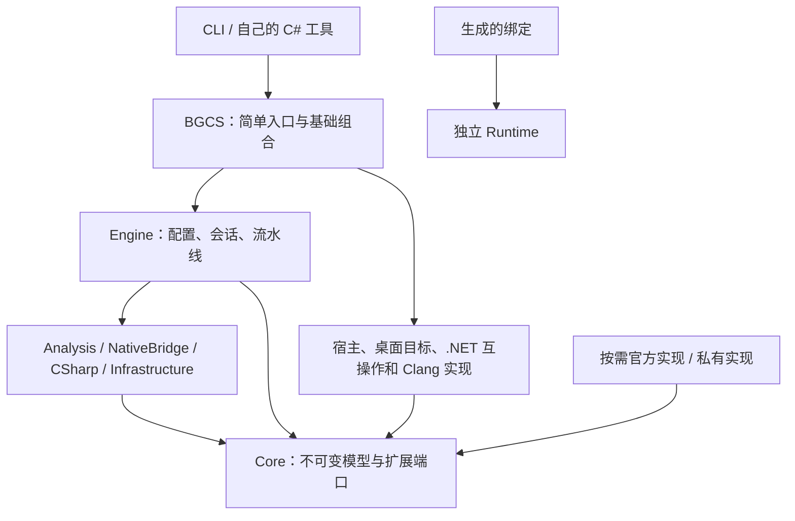

# 架构

BGCS 是源码生成器，另有独立的绑定 Runtime。CLI 与 C# 调用使用同一个 Engine；消费项目自行编译、链接、包装、部署和运行。

## 分层



`BGCS` 是组合入口；`BGCS.Engine` 不引用具体 frontend、宿主或目标实现。默认组合只在完整产品入口创建。内部程序集随 BGCS 交付，不要求用户逐个安装。

| 模块 | 职责 |
| --- | --- |
| Core | 中立事实、请求、诊断、类型化计划与接口。 |
| Analysis | 声明选择、布局、语义、安全与契约复核。 |
| NativeBridge | C/C++ 转换、类型化操作与桥接源码。 |
| CSharp | 托管投影、调用/导入计划与 C# 源码。 |
| Infrastructure | 文件身份、协议、扩展加载、缓存与发布事务。 |
| Engine | 冻结配置、会话与生成阶段协调。 |
| BGCS | 简单公开入口和明确的基础注册。 |
| Runtime | 原生模块、调用、资源与生命周期。 |
| Tool | 参数与呈现，通过统一公开流程执行。 |

具体实现位于 `extensions/foundation`、`extensions/frontends` 与独立 `BGCS.Extension.*` 工程。边界由工程依赖矩阵和源码检查约束，不能只凭目录判断。

## 数据流

```text
配置 + 显式注册
→ 宿主设施 → 本地配置与扩展输入 → 冻结
→ 目标/runtime → frontend 准备 → 输入完整的缓存查询
→ NativeModule → 选择与语义
→ 按需 NativeBridgePlan → 源码与桥接头复核
→ InteropModule → 精确调用计划 → ManagedApiModel
→ CSharpEmissionPlan → 后处理 → 最终静态契约检查
→ 输入再次校验 → 完整产物发布
```

原生事实不提前变成 C# 字符串。存储布局、载体布局和调用兼容性分别验证。调用计划绑定精确签名、方向、target/triple、runtime 摘要和 ABI provider，不能用于另一份签名。

C/C++ 共用类型化桥接模块。桥接明确物理导出与原始声明的映射。emitter 不发现或执行编译器；生成的操作与静态断言交给消费项目编译。

## 扩展首先是接口实现

普通类可以直接用 `RegisterFactory<T>` 注册。`IBindingPlugin` 只是组织一组注册的便利方式；本地 manifest 为 CLI 加载已经部署的实现。不自动扫描程序集，不在生成时下载包。

descriptor 是 ID、端口和 priority 的唯一权威。重复注册失败；冻结前替换必须显式指定。独占 provider 必须明确选择或唯一适用；可组合变换按 priority 和稳定 ID 排序。

宿主设施在读取配置前通过代码选择。后加载的 manifest 不能替换读取它时使用的路径规则。服务由会话拥有；不能完整描述的可变工厂状态会禁用受影响缓存。

## 生命周期与发布

生成服务作用域和宿主基础设施作用域分开。frontend、transform、processor、validator 在最终输入复核和提交前释放；释放失败阻止发布。路径服务持续存活到锁与事务安装结束。

结果区分未发布、成功发布，以及已提交产物但后续基础设施清理失败；不会把已经提交伪装成从未发生。

Runtime 不依赖 Core 或生成器。调用、对象、回调和异步任务仍需要原生代码时，module lease 阻止卸载。平台调度通过明确的 Runtime 接口或生成适配代码提供。

## 维护原则

新 SDK 输入、现有模型能表达的 ABI 规则、库语义与 API 呈现，通常通过新增接口实现解决。已复现缺陷或现有模型无法表达的机制，仍可能要求修复核心；不能承诺核心永不修改。

不通过兼容 namespace、旧配置读取、平行注册表、生产友元或私有反射测试绕过边界。仍适用的第三方许可继续保留。

参阅[扩展](extensibility.cn.md)、[原生桥接](native-bridge.cn.md)、[Runtime](runtime-lifetime.cn.md)与[维护](maintenance.cn.md)。
