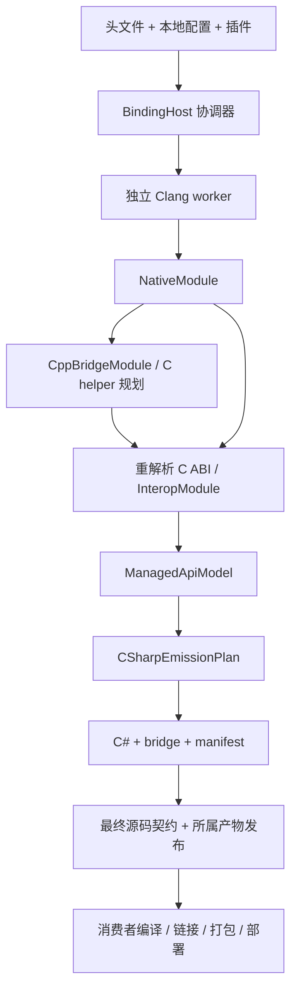

# BGCS 3.0 架构

[English](architecture.md) | [文档](README.cn.md) | [评估](assessment.cn.md)

BGCS 是源码生成器。`BindingHost` 协调本地生成会话，不是网络服务；CLI 和普通 SDK 调用
使用相同流程。本文描述源码边界，不是已经完成的验收回执。

## 十一个模块，四个产品

完整 SDK/工具交付内部模块。用户选择 `BGCS`、`BindGen-CS`、供普通插件使用的
`BGCS.Contracts`，或供生成应用使用的 `BGCS.Runtime`。

| 模块 | 职责 |
| --- | --- |
| BGCS.Contracts | 分离的不可变 native/bridge/interop/managed 事实及中立端口 |
| BGCS.Infrastructure | 快照、缓存、发布、插件加载与 worker 传输 |
| BGCS.Frontend.Clang | C/C++ 解析事实、类型图、源码与布局 |
| BGCS.Frontend.Clang.Worker | 版本化的独立解析进程及高级贡献器 |
| BGCS.Platforms | 宿主/目标、ABI 和只读 SDK/工具链描述 |
| BGCS.Analysis | 选择/闭包、存储、调用 ABI 和语义安全 |
| BGCS.Cpp2C | 类型化 C++ lowering，发射 C bridge 和断言源码 |
| BGCS.CSharp | 托管投影、发射规划、C# 与最终契约检查 |
| BGCS.Runtime | 独立的消费者调用、lease、handle、buffer、codec 和 callback |
| BGCS | 配置、扩展会话、流水线、工作区与发布 |
| BGCS.Tool | CLI 请求、诊断和取消 |

[工程依赖策略](../eng/architecture/project-dependencies.json)是机器可读边界。
Contracts/Runtime 无其他 BGCS 依赖；Analysis 和普通 lowering 不持有 Clang AST。
Host 经协议调用 worker，进程隔离不是不可信插件沙箱。生产友元绕过和共享编译源码
被禁止，登记的 Frontend.Tests 友元仅为测试例外。

## 模型与流程

原生事实、bridge 操作、ABI 语义和托管呈现分别归属不同模型，通过稳定 ID 连接。
未知事实保持未知，发布模型不携带 parser handle 或运行服务；等大小不证明字段、
对齐或调用约定相同。

C++ 构造/析构、调用、转换、cast、callback 和异常是有限类型化操作。发射的 C 头文件
会重解析检查导出 ABI。bridge 和存储断言由外部编译器编译，BGCS 不编译它们或检查
原生目标文件。C header helper 需显式启用并编译进消费者配置的模块，不能假设已有依赖
二进制自动具备这些导出。

## 宿主、目标与 SDK

执行宿主选择 parser 资源，省略目标时解析检测到的宿主（含 GNU/musl 区别）。显式目标
选择 CPU/platform/ABI，provider 映射描述和能力，Clang 观察声明与布局。
显式 SDK/sysroot/header 输入具有权威性；随包 Clang builtin headers 只补充目标 SDK
及 C++ 头文件。产品不会运行外部 driver 来修补不支持的源码或替换编译器专属声明。

Windows 可用 Windows worker 加显式 NDK 输入，为 Android ARM64 生成绑定。消费者构建
须保持头文件、宏、packing、ABI 一致。私有目标插件可以描述获授权的 SDK，但不能凭空
提供未知调用分类或托管 runtime 行为。见[平台扩展](platform-extension.cn.md)
和 [CustomTargetPlugin](../examples/CustomTargetPlugin/README.md)。

## 托管投影与 Runtime

FunctionTable、DllImport、LibraryImport 共用 interop 语义和受检计划。Raw 使用生成的
原生 carrier；string、span、owned、callback、async 友好层需要明确生命周期、allocator
和长度证据。无法支持的 ABI/生命周期组合会失败或保留明确说明的 Raw 路径。

`api.projectionInputs` 冻结源码、引用镜像和 defines，供静态 Roslyn 绑定。BGCS 不发射/
加载消费者程序集、不运行工程或布局探针。标量字段复制不能授权未知 CLR 布局直接
复用原生 ABI，原生存储和按值资格仍单独检查。

生成上下文拥有模块会话，调用及资源保留清理 lease；关闭后拒绝新调用，不会卸载仍被
清理使用的代码。Runtime 不依赖生成器。package/source 是交付选择，不改变所有权规则。
不可阻塞 browser profile 不能采用需要阻塞 stop/join 的拥有型虚代理注册协议。

## 扩展、缓存与发布

Contracts-only 服务具有声明身份、顺序和会话生命周期；高级 Clang 贡献器仅在 worker
调用期间借用 parser handle。指纹包含扩展状态和外部输入，不完整则禁用相应复用。
相关缓存命中仍执行最终 validator/processor。

配置组合只读取本地文件，保留固定内容身份及每份文档的相对路径基准，拒绝网络配置。
输入字节、目录成员和缺失事实会复核，不用时间戳或旧结论替代。发布按 owner、完整
产物集合、锁和恢复 journal 检查；不承诺任意变化文件系统的原子快照。

## 验收边界

必需 CI 是 Windows 完整生成、Linux/macOS 生成 smoke，以及一个完整产品安装任务。
核心基线、源码/API/依赖检查和原有各宿主性能预算保持必需。AOT/Wasm 应用构建是可选
手动私有检查。目标/源码支持仍属范围，平台调用结论另需实际证据。见[测试](testing.cn.md)
和[验收](acceptance.cn.md)。
