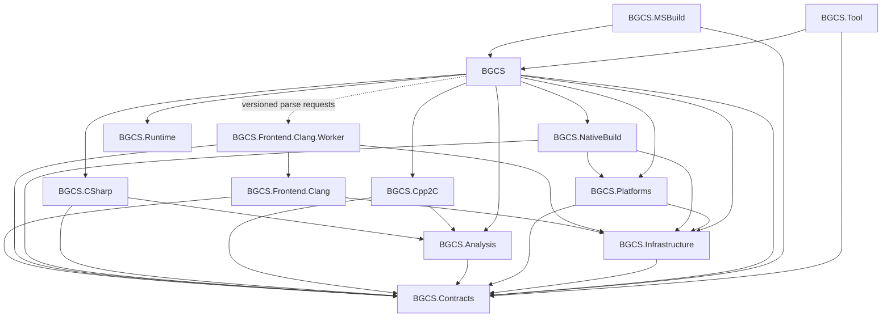
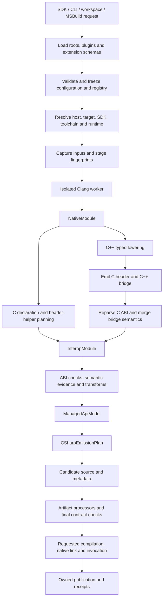
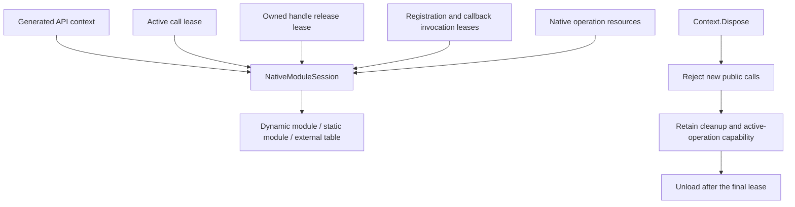

# BGCS 3.0 architecture

[简体中文](architecture.cn.md) | [Documentation index](README.md) | [Implementation status](implementation-status.cn.md)

The 3.0 public entry point is `BindingHost`, using grouped configuration and a neutral model pipeline. This document defines the release boundaries and explains the primary implementation. It is not a passing acceptance receipt: the [architecture policy](../eng/architecture/project-dependencies.json), [feature inventory](../eng/acceptance/feature-inventory.json), actual test receipts and same-revision CI determine completion. Residual old public generators or forbidden project references are release blockers, even if the new Host path works.

## Modules and product packages

There are thirteen implementation projects. Project boundaries describe ownership; NuGet packages describe delivery. Users install the complete `BGCS` SDK or `BindGen-CS` tool, plugin authors can reference only `BGCS.Contracts`, and generated-code consumers can reference only `BGCS.Runtime`. Internal modules do not become a list of products that users must assemble.

| Project | Responsibility |
| --- | --- |
| `BGCS.Contracts` | Immutable native/bridge/interop/managed models, evidence, diagnostics and extension ports |
| `BGCS.Infrastructure` | Files, processes, serialization, worker communication, plugin loading, caches and publication |
| `BGCS.Frontend.Clang` | Extract Clang declarations, type graphs, source and layout facts into neutral models |
| `BGCS.Frontend.Clang.Worker` | Execute the parser in an isolated process with a versioned protocol |
| `BGCS.Platforms` | Resolve host, target, SDK, toolchain, managed runtime and asset capabilities |
| `BGCS.Analysis` | Declaration closure, ABI/storage analysis, semantic evidence and safety eligibility |
| `BGCS.Cpp2C` | Plan C++ lowering and C header helpers; emit typed native bridge operations |
| `BGCS.CSharp` | Project managed APIs, plan imports/conversions/cleanup and emit C# |
| `BGCS.NativeBuild` | Produce and execute native build plans, inspect exports and package native assets |
| `BGCS.Runtime` | Independent consumer module sessions, leases, handles, buffers, codecs and callbacks |
| `BGCS` | Compose defaults, configuration, extensions, sessions, workspaces and the public Host |
| `BGCS.Tool` | Map CLI arguments and cancellation into Host requests; present results |
| `BGCS.MSBuild` | Opt-in build tasks, parser asset deployment and exact manifest item integration |

The required project-reference graph follows. A solid arrow is a managed project reference; the dashed edge is the worker process protocol.

`Contracts` and `Runtime` have no other BGCS project dependencies. Ordinary lowering and managed backends do not reference Clang. The Host communicates with the worker rather than parsing native code inside an SDK application's process. Source files have one owning project; linked production source and visibility bypasses cannot substitute for a contract.

## Models and pipeline

| Model | Meaning |
| --- | --- |
| `NativeModule` | Source declarations, exact native types/layouts, templates, inheritance and target facts |
| `CppBridgeModule` | Typed native operations, exports, conversions, exceptions and lifetime protocols |
| `InteropModule` | Final C ABI with ownership, allocator, string, buffer, callback and error contracts |
| `ManagedApiModel` | Managed types, members, public projection and Runtime requirements |
| `CSharpEmissionPlan` | C# imports, carriers, layouts, conversion/pinning/cleanup and file decisions |

Models retain stable IDs and source provenance. Unknown facts remain unknown; a matching size is not proof of matching fields, alignment or calling convention. Published models do not retain parser cursors, native handles, mutable configuration or running services.

C++ callers use the same configuration and Host entry point as C callers. C++ bridge operations include construction/destruction, calls, argument and result conversion, ownership, inheritance casts, callback dispatch and exception boundaries. C++ exceptions are translated at the C boundary. Reparsed C declarations provide actual exported ABI facts; stable export identities retain lowering semantics when those facts are merged.

C inline/internal-linkage functions are not automatically dynamic exports. Their generated C helper header/source must be compiled into the configured native module, and prebuilt mode verifies the required adapter exports. On Windows, a helper-only DLL does not inherit the exports of its dependency DLLs. A source-build plan and a standalone native manifest must carry the helper inputs explicitly.

`generate` publishes source after its required model, safety and source-contract checks. `build` additionally validates managed compilation and the configured native inputs before replacing final output. `nativeBuild.mode=none` remains explicitly unverified native construction. A successful generation receipt does not certify native linking or invocation.

## Host, target and runtime are separate

The authoring host selects the parser worker/native parser resources. The native target selects CPU/OS/ABI facts. The SDK/sysroot supplies headers and libraries. The native compiler/linker determines construction. The managed runtime and import mode determine supported invocation mechanisms.

For example, Windows x64 can run a `win-x64` parser while generating Android ARM64 declarations from an NDK sysroot. The parser host must not be chosen from the generated target. Likewise, a NuGet RID is an asset-selection identity rather than a complete ABI description; GNU and musl assets cannot share a misleading RID.

Clang is the default frontend because it supplies mature C/C++ parsing. It does not require the final library to be built with Clang. Actual compiler preprocessing, headers, layouts and calling ABI still need agreement. Compiler-specific declarations that cannot be reproduced by the selected native compiler must fail validation, not be treated as interchangeable.

The embedded Clang builtin header bundle is distinct from system SDK/C/C++ headers. Its provenance, hash and license are [recorded with the resources](../src/BGCS.Frontend.Clang/Resources/Clang/README.md). An unrelated LLVM installation must not silently replace those resources.

Browser Wasm uses a static native module/adapter, native build references and AOT-compatible callback mechanisms. Desktop dynamic loading is one capability, not a universal implementation. Emscripten and WASI are distinct targets. New target families should supply capabilities and toolchain facts rather than add target-name branches throughout emitters.

## ABI and managed API planning

Storage layout, managed allocation alignment and by-value calling classification are independently checked. Over-aligned records, special numeric types, packed aggregates, unions and callbacks need their own evidence. Unsupported by-value signatures require a pointer/native bridge; byte storage of a type does not authorize calling with that type.

The raw API preserves expressible ABI access. Friendly strings, spans, owned wrappers and asynchronous operations require sufficient lifetime/allocator/length/encoding evidence. `char*` is not inherently UTF-8; `wchar_t` is resolved from target facts. The evidence levels distinguish inference, declarations, user assertions and independent verification.

FunctionTable, DllImport and LibraryImport consume the same interop semantics. The backend first plans native carriers, public types, pinning, allocation, conversion, error handling and cleanup. Emitters execute the plan instead of deriving separate semantics for each import mode. Instance contexts are the default; explicit static APIs have documented shared-module lifetime behavior.

## Runtime ownership

Context disposal cannot unload a module that is still needed for active calls, destructors, callbacks or native asynchronous work. Cancellation alone does not prove that native code stopped using a buffer. Retained callbacks require an unregister/end protocol and must not deadlock while closing from their own invocation.

The Runtime package is independent of generation/parser dependencies. Source Runtime mode selects a versioned source closure and rewrites syntax/namespace references, allowing multiple binding libraries to coexist. Package/source and split/single-file modes require actual consumer tests.

## Extensions, configuration and caching

A standard plugin references `BGCS.Contracts` and registers typed ports. The same frozen registry serves SDK, CLI, workspaces and MSBuild. Services have stable IDs, ordering, conflict rules and lifetimes. Clang-specific fact contributors are a worker-only advanced surface; normal lowering should consume neutral models. [Extensibility](extensibility.md) describes ports and [the cookbook](cpp-extension-cookbook.md) provides implementations.

Configuration composition preserves explicit false/zero/list semantics and each local document's own path base. Pinned HTTPS bases require an explicit URL, SHA-256 and local `pathBase`; remote input provenance stays separate from local file dependencies. Request creation and workspace loading propagate cancellation before generation begins. Fetching a declared configuration does not install SDKs or compilers.

Generation-stage reuse currently concerns the primary frontend result and eligible C# emission. Keys account for implementation/worker/resource identities, resolved target/toolchain, frozen configuration, source/include membership and extension inputs. Unknown fingerprints disable affected reuse. Transforms, artifact processors and requested validation still execute; a cache hit cannot skip this request's native build or invocation. Native construction is not represented as a completed native-build cache merely because generated source was reused.

Caches contain immutable verified file sets. Corrupt entries become misses. Candidates are published through ownership checks, stable locks and a recovery journal, preserving the previous complete output on required validation failure. Input/output/cache overlap, path escape and conflicting artifact names fail. Multi-directory publication requires the documented lock/manifest protocol; ordinary filesystems do not provide a universal cross-directory atomic transaction.

## Integration and evidence

The CLI presents Host results and diagnostics. MSBuild is a separate implementation project shipped inside the SDK; generation requires opt-in, uses its own .NET TaskHost, skips default design-time generation and imports exactly the files in the manifest into each isolated inner build. Cancellation covers configuration fetch, worker parsing and construction. It does not duplicate generator business logic.

The release requires architecture/source ownership gates, complete feature mapping, actual desktop/native/AOT/browser calls, clean package installation, reviewed source/API snapshots, bounded performance and supply-chain evidence. The NativeAOT fixture requires 113 checks including independent aggregate comparisons; browser interpreter/AOT require their separate 74-check matrix. Finite CPU-side corpus calls do not certify every feature of an upstream library or bgfx GPU rendering.

Every platform claim records its stage: resolution, parsing, generation, managed compilation, native linking, invocation and package consumption. A local dirty checkpoint or an old successful release cannot certify the current revision. The source of release requirements is [the gate manifest](../eng/acceptance/required-release-gates.json), with details in [testing](testing.md), [packages](packages.md) and [ABI safety](abi-safety.md).
