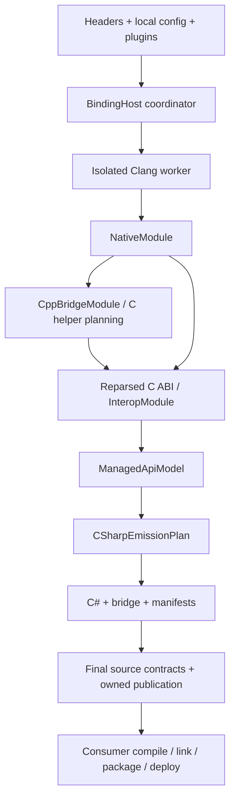

# BGCS 3.0 architecture

[简体中文](architecture.cn.md) | [Documentation](README.md) | [Assessment](assessment.md)

BGCS is a source generator. `BindingHost` coordinates a local generation session;
it is not a network service. CLI and ordinary SDK calls use the same pipeline.
This document describes source boundaries, not a completed acceptance receipt.

## Eleven modules, four products

The complete SDK/tool delivers internal modules. Users choose `BGCS`, `BindGen-CS`,
`BGCS.Contracts` for ordinary plugins, or `BGCS.Runtime` for generated consumers.

| Module | Responsibility |
| --- | --- |
| BGCS.Contracts | Detached immutable native/bridge/interop/managed facts and neutral ports |
| BGCS.Infrastructure | Snapshots, cache, publication, plugin loading and worker transport |
| BGCS.Frontend.Clang | C/C++ parser facts, type graphs, source and layouts |
| BGCS.Frontend.Clang.Worker | Versioned isolated parser process and advanced contributors |
| BGCS.Platforms | Host/target, ABI and read-only SDK/toolchain descriptions |
| BGCS.Analysis | Selection/closure, storage, calling ABI and semantic safety |
| BGCS.Cpp2C | Typed C++ lowering and C bridge/assertion source emission |
| BGCS.CSharp | Managed projection, emission planning, C# and final contract inspection |
| BGCS.Runtime | Independent consumer calls, leases, handles, buffers, codecs and callbacks |
| BGCS | Configuration, extension sessions, pipeline, workspaces and publication |
| BGCS.Tool | CLI requests, diagnostics and cancellation |

[Project dependency policy](../eng/architecture/project-dependencies.json) is the
machine-readable boundary. Contracts and Runtime have no other BGCS dependency.
Analysis and ordinary lowerings do not hold Clang ASTs. Host communicates with the
worker through a protocol; process isolation is not a sandbox for untrusted plugins.
Production friend bypasses and shared compilation links are forbidden. The registered
Frontend.Tests friend is a test-only exception.

## Models and flow

Native facts, bridge operations, ABI semantics and managed presentation have separate
ownership. Stable IDs connect them; unknown facts remain unknown. Published models
contain no parser handles or running services. Equal size alone proves neither fields,
alignment nor calling convention.

C++ construction/destruction, calls, conversions, casts, callbacks and exceptions are
finite typed operations. Emitted C headers are reparsed to check exported ABI facts.
The resulting bridge and storage assertions are source for an external compiler; BGCS
does not compile them or inspect native objects. C header helpers require opt-in and
must be compiled into the consumer's configured native module, not assumed to exist
in an already built dependency.

## Host, target and SDK

The execution host chooses parser resources. An omitted target resolves the detected
host, including GNU/musl identity. Explicit targets choose CPU/platform/ABI facts;
providers map descriptors and capabilities, and Clang observes declarations/layouts.
Explicit SDK/sysroot/header inputs are authoritative. Bundled Clang builtin headers
supplement rather than replace target SDK and C++ headers. No external driver is run
to repair unsupported source or patch compiler-specific declarations.

Windows can generate for Android ARM64 with its Windows worker and explicitly supplied
NDK inputs. Consumer builds must use compatible headers, defines, packing and ABI.
Private target plugins can describe licensed SDKs but cannot create unknown calling
classification or managed runtime behavior. See [platform extension](platform-extension.cn.md)
and [CustomTargetPlugin](../examples/CustomTargetPlugin/README.md).

## Managed projection and Runtime

FunctionTable, DllImport and LibraryImport share interop semantics and checked plans.
Raw imports use generated native carriers. Friendly strings, spans, owned objects,
callbacks and async operations require explicit lifetime/allocator/length evidence.
Unsupported ABI or lifecycle combinations fail or retain a documented raw-only route.

`api.projectionInputs` supplies frozen source, reference images and defines for static
Roslyn binding. BGCS does not emit/load a consumer assembly, run a project or execute
a layout probe. Scalar field copies do not grant direct ABI reuse of an unknown CLR
layout. Native storage and by-value eligibility remain independent checks.

Generated contexts own module sessions. Calls and resources retain cleanup leases;
closing prevents new calls without unloading code still needed for cleanup. Runtime
has no generator dependency. Package and emitted-source Runtime are delivery choices,
not different ownership semantics. Nonblocking browser profiles cannot use an owning
virtual-registration protocol that requires blocking stop/join.

## Extensions, cache and publication

Contracts-only services have declared identities, ordering and session lifetimes.
Advanced Clang contributors borrow live parser handles only during the worker call.
Fingerprints include extension state and external inputs; missing complete fingerprints
disable affected reuse. Final validators/processors still run on relevant cache hits.

Configuration composition is local, with pinned local input identities and per-document
relative bases. Network configuration is rejected. Input snapshots, directory membership
and absence facts are rechecked; no timestamps or previous verdict replace byte proof.
Publication validates ownership and the complete artifact set under locks/journal recovery.
It does not promise atomic snapshots of an arbitrary changing filesystem.

## Acceptance boundary

Required CI has Windows full generation, Linux/macOS generation smoke, and one full
installed-product job. Core baselines, source/API/dependency checks and original
per-host performance budgets remain required. AOT/Wasm application builds are optional
manual private checks. Target/source support remains in scope, while platform invocation
claims require their own actual evidence. See [testing](testing.md) and [acceptance](acceptance.md).
