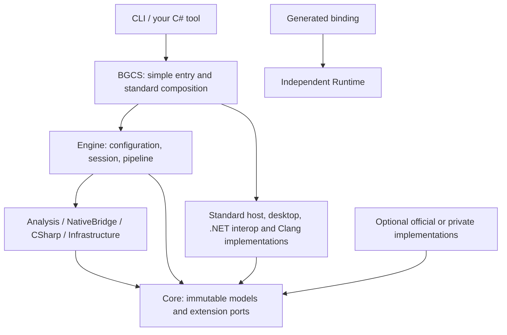

# Architecture

BGCS is a source generator with a separate binding Runtime. Both CLI and C# entry points use the same Engine. Compilation, linking, packaging, deployment and application execution belong to the consumer.

## Layers



`BGCS` is the composition root. `BGCS.Engine` can be built without concrete frontend, host or target implementations. Default construction exists only in the complete product entry point. Internal assemblies ship with BGCS; they are not additional packages users must assemble.

| Owner | Responsibility |
| --- | --- |
| Core | Neutral facts, requests, diagnostics, typed plans and interfaces. |
| Analysis | Declaration selection, layout, semantics, safety and contract verification. |
| NativeBridge | C/C++ conversions, typed operations and bridge source emission. |
| CSharp | Managed projection, call/import planning and C# source. |
| Infrastructure | File identity, protocol, plugin loading, caches and publication transactions. |
| Engine | Frozen configuration, sessions and ordered generation stages. |
| BGCS | Public convenience entry and explicit standard registrations. |
| Runtime | Native modules, calls, resources and lifetime support. |
| Tool | Arguments and presentation, using the same public generation flow. |

Specific implementations live in `extensions/foundation`, `extensions/frontends` and optional `BGCS.Extension.*` projects. Directory placement does not itself establish a boundary: the reviewed project dependency matrix and source checks enforce it.

## Data flow

```text
Configuration + explicit registrations
→ host facilities → local configuration and extension inputs → freeze
→ target/runtime resolution → frontend preparation → input-aware cache lookup
→ NativeModule → selection and semantics
→ NativeBridgePlan when required → source and bridge-header verification
→ InteropModule → exact call plans → ManagedApiModel
→ CSharpEmissionPlan → source processing → final static contract checks
→ input revalidation → complete artifact publication
```

Native facts are not C# strings. Storage layout, carrier layout and call compatibility are independent. A call plan binds its signature, direction, target/triple, runtime digest and ABI provider; it cannot be replayed against another signature.

C/C++ share a typed bridge owner. A bridge describes physical exports and logical source mappings. No emitter searches for a compiler or invokes a consumer build. Bridge source contains language-level operations and assertions for the consumer's compiler.

## Interfaces, not a plugin requirement

An extension can be an ordinary class registered through `RegisterFactory<T>`. `IBindingPlugin` optionally groups registrations; local manifests optionally load already deployed code for the CLI. Nothing scans assemblies or downloads packages at generation time.

A descriptor alone owns service identity, port and priority. Registration rejects duplicates. Replacement is explicit before freezing. Exclusive providers require an explicit selection or a unique applicable result. Composable transforms have deterministic priority/ID ordering.

Host facilities must be selected through code before reading local configuration. A later manifest cannot replace the path rules used to read itself. Service instances belong to a session. Untracked mutable factory state prevents affected cache reuse.

## Lifetime and publication

The generation service scope and host infrastructure scope are separate. Frontend, transformations, processors and validators release before the final input fence and commit; cleanup failure blocks publication. Host path services remain alive through locking and transaction installation.

The result distinguishes no publication, successful publication, and committed artifacts followed by infrastructure cleanup failure. It does not pretend a committed transaction never happened.

Runtime is independent of Core and the generator. Its module leases preserve code while a call, owned object, callback or operation still needs it. Platform-specific scheduling is explicitly supplied through Runtime interfaces or generated adapters.

## Maintenance rules

New SDK inputs, existing-model ABI rules, library semantics and projection rules should normally add interface implementations. A reproduced defect or a mechanism that existing models cannot express can require a core fix. No claim is made that the core will never change.

No compatibility namespace, old configuration reader, parallel registry, production friend assembly or private reflection test is used to bridge the new boundaries. Applicable third-party licenses remain part of distribution.

See [extension interfaces](extensibility.md), [native bridges](native-bridge.md), [Runtime lifetimes](runtime-lifetime.md) and [maintenance](maintenance.md).
