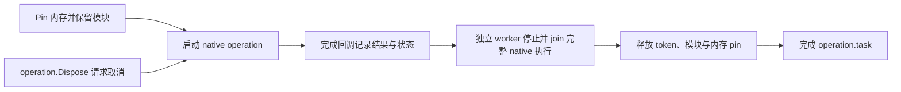

# 托管回调与原生异步操作

BGCS 分开保存回调的精确 ABI 与生命周期。选中的具名回调 typedef 可以生成独立
delegate 声明；这不代表原生代码已停止保留回调地址。设置
`api.emitCallbackDelegates = false` 可以关闭这些独立声明，raw 导入仍使用函数指针。
已配置的回调包装仍会生成自己需要的 handler 类型。

## 同步回调

需要明确声明 native 生命周期、是否保留、线程与异常返回值：

```json
"semantics": {
  "callbackParameters": [{
    "function": "CallState",
    "parameter": "callback",
    "lifetime": "call",
    "retained": false,
    "threading": "callerThread",
    "userDataParameter": "state",
    "callableUserDataIndex": 1,
    "failureReturn": "-9"
  }]
}
```

对于 `int (*callback)(int value, void* state)`，state 变为自动管理的 opaque token，
托管重载接受 `value => ...`。静态 thunk 可用于 AOT；token 不是可解引用的 GC
handle，释放后不会复用。没有 native user-data 通道时，CoreCLR 包装把精确 delegate
保活到整个调用返回；AOT 需要显式 user-data 通道。

```csharp
int result = api.CallState(value => value + 11, 31);
```

托管异常先被捕获，并向 native 返回声明的 fallback。native 返回后，包装才重新抛出
原始异常。void 回调省略 `failureReturn`；指针返回值必须显式写字符串 `"null"`。
原生 bool 回调保留精确的 byte ABI。回调可以组合已验证的字符串、span 与单值转换：

```csharp
int[] values = [1, 2];
int state = 10;
int result = api.CallComposed(value => value + 3, "AB", values,
    out int written, ref state);
```

未转换的指针参数仍然明确呈现为 unsafe 指针。回调契约不会推断这个指针的所有权、
长度或保留行为。

经过检查的 C++ 标量、void 或拥有型结果 status bridge 会复用已有状态操作。
先完成 native error 清理，再重新抛出原始托管回调异常；如果 native 已成功创建拥有型
结果，抛出前先 Dispose 该结果，释放失败则与回调异常一并报告。别名、具名函数视图
和静态 facade 都转发到同一已检查重载。

拥有型 C++ 实例成员也可以使用同一回调投影，前提是精确的 receiver 身份与已选择的
拥有型 factory 一致，且不移除原生 const/volatile 限定。receiver 必须具有明确的借用
Call 生命周期；矛盾的保留声明会被拒绝，未知的 receiver 保留事实仍然是未知。
包装在完整 native 执行帧结束前持有 receiver 的资源 lease，不会因此声明 native 可以
在返回后继续保留这个对象。临时 buffer、固定的值和 callback 地址分别需要明确的
不保留契约。

`widget.CallState(handler, value, fail)` 与
`api.CallState(widget, handler, value, fail)` 使用一次取得并保持有效的 callback 地址，
共享同一已检查 context；跨 context 的对象会被拒绝。实例成员的拥有型返回结果复用
factory 的接管与释放协议；callback 异常或 native 输出计数越界时，先释放已接管的
结果，再重新抛出。回调中释放自身或其他线程并发 Dispose，都会等当前完整 native
帧返回后才释放对象。module-borrowed receiver 不会自动获得这条拥有型投影。

本地回归已在 Windows x64 CoreCLR 实际执行三种 import、Runtime 包/源码模式，
包含静态 facade 和源码单文件输出。这些证据不代表 NativeAOT、浏览器 Wasm 或其他
操作系统已认证；静态反向调用 profile 仍要求明确的 user-data 与受支持的生成 thunk。

## 返回 handle 的长期注册

返回 handle 的形式要求 factory 返回原生指针，并提供固定签名的
`void StopAndJoin(Handle*)`。join 必须禁止新调用，并等待所有仍使用 callback/state
的完整 native 执行帧结束。

```json
{
  "function": "Register",
  "parameter": "callback",
  "lifetime": "registration",
  "retained": true,
  "threading": "anyThread",
  "userDataParameter": "state",
  "callableUserDataIndex": 1,
  "failureReturn": "-7",
  "unregisterFunction": "StopAndJoin",
  "unregisterQuiescence": "noActiveNativeInvocations",
  "registration": {
    "unregisterHandleParameter": "handle",
    "nullResultQuiescence": "noActiveNativeInvocations",
    "releaseThreadDomain": "any"
  }
}
```

这些是用户明确作出的断言，不会自动升级为独立 Verified 证据。返回 null 时必须不再
保留任何活动 native 使用；任意线程清理也必须符合实际库的要求。

```csharp
using var registration = api.Register(value => value + 3, 0);
int result = registration.Invoke(handle => api.Raw.Trigger(handle, 38));
Exception? callbackFailure = registration.TakeCallbackException();
```

state 在 factory 开始前建立，因此支持注册期间的同步回调。在回调内 Dispose 会把
关闭工作派发到该回调外。公开 native 使用先排空，再执行完整 native join，最后释放
token 与模块。join 失败会保留资源，通过 `closeFailure` 暴露错误并允许重试。
`DisposeAsync` 在允许的清理线程上等待关闭；应在该注册的活动回调之外 await。

关闭 API context 会拒绝新公开调用，但现有注册继续保留清理模块的能力。
`DangerousGetNativeHandle` 暴露的外部 unsafe 使用也必须遵守同一 native 关闭协议。
不允许同步 native join 的浏览器 profile 保留 raw ABI，并说明拥有型投影缺少的条件。

## callback 与 user-data 成对注册

另一些库使用同一个 callback 地址与 user-data 对识别注册，例如
`bool Register(Callback callback, void* state)` 和
`void StopAndJoin(Callback callback, void* state)`。保留上面的 callback 生命周期、
线程、state 通道与完整 unregister quiescence 声明，改用以下 `registration`：

```json
"registration": {
  "kind": "callbackAndUserData",
  "unregisterCallbackParameter": "callback",
  "unregisterUserDataParameter": "state",
  "successfulReturn": "1",
  "failureResultQuiescence": "noActiveNativeInvocations",
  "releaseThreadDomain": "any"
}
```

生成器只取得一次原生 callback 地址，注销时按声明的参数顺序传入完全相同的地址和
不可复用的 state token。void 注册省略 `successfulReturn`；标量注册明确声明精确的
原生成功值，并保证其他返回结果不留下任何活动 native 使用。返回 pointer 与成对身份
是两种不同协议；当前异步操作投影仍要求返回 operation handle。

生成注册具有同样的 `Dispose`、`DisposeAsync`、`completion` 和
`TakeCallbackException`。unsafe 身份入口名为 `DangerousGetNativeUserData`，
`Invoke` 接收 opaque `nint` token；它不是可以解引用的托管 state 指针。如果原生
remove 只禁止未来回调，却不等待正在执行的完整 native 帧，就不满足这个拥有型
协议，仍保留正确 raw ABI。

## 完成与取消

`semantics.asyncOperations` 将 operation 生命周期的回调注册连接到明确的结果/status
参数索引、成功/取消值、可选取消入口与保留的 buffer 身份。生成的 `StartAsync`
返回 `NativeOperation<TResult>`：

```csharp
using var operation = api.StartAsync(memory, mode: 0);
int result = await operation.task;
```

operation 生命周期的标量 buffer 使用 `Memory<T>`。调用前验证精确元素边界、null
规则与实际 pin 后地址的对齐。task 完成前不要复用这块内存或 Dispose 它的底层 owner。



取消请求不会释放 buffer，也不会使 task 提前完成。取消确认来自声明的终态 native
status。完成回调可以早于 Start 返回；关闭过程会等待返回 handle 发布。进入完成回调
本身不能证明 native 执行帧已停止访问内存或模块代码。

可执行规范见 [同步回调](../tests/BGCS.Tests/NativeCallScopedCallbackTests.cs)、
[长期回调](../tests/BGCS.Tests/NativeRetainedCallbackTests.cs) 与
[异步操作](../tests/BGCS.Tests/NativeAsyncOperationTests.cs)。测试源码不等于平台认证；
认证仍需要同一 revision 的实际执行收据。生命周期、quiescence 或表示能力不足时，
保留正确 raw ABI，并给出托管投影缺失的诊断。

## 非阻塞事件循环关闭

事件循环注册需要明确声明 `threading: "eventLoop"`、
`registration.releaseThreadDomain: "eventLoop"` 与
`registration.unregisterIsNonBlocking: true`。native unregister 必须在不阻塞事件循环
线程的前提下建立 `noActiveNativeInvocations`。这些是用户对原生库协议的明确断言，
不能用于任意线程回调或会阻塞的 unregister。

生成的 factory 在保留资源前捕获 `NativeCallbackDispatcher`。关闭被排到当前 native
执行帧返回之后，异步等待 handle 发布和已进入的 native 使用结束，再在捕获的线程
上注销。`Dispose()` 只请求关闭；`await DisposeAsync()` 等待完整清理，应在被关闭的
回调之外 await。回调中释放自身会延迟执行，使 native 调用能够先返回。注入的
dispatcher 必须稍后在同一线程执行，不能内联或在活动 native 帧内泵送队列；
无效队列或线程会导致关闭失败，且不执行 native unregister。

事件循环异步取消还需要 `cancellationIsNonBlocking: true`。取消仍只是请求。
pin、token 和模块 lease 会保留到 native 完成、排队的 stop 操作与托管调用全部
结束。native 完成回调返回后继续访问 buffer 的情况，依赖单独的完整 quiescence
stop 协议，不能在完成回调入口提前释放资源。

浏览器生命周期 fixture 在原有 74 项 raw 调用检查之外，分别对解释执行与 AOT
选定该可选私有应用检查时执行全部 33 项断言。实现完成和桌面编译通过不等于浏览器认证；应查看同 revision
的实际执行收据。

Browser Wasm profile 对导入签名中直接出现的函数指针参数和返回值使用明确的
wasm32 表索引传输能力。生成的私有转发方法执行受检查的地址转换；公开 raw API
仍使用带类型的函数指针，支持空值及返回 callback。该能力要求静态 native module
adapter，以及已知的 32 位、小端 C 调用 ABI；它不构成 aggregate 按值调用的依据。
自定义 runtime profile 需要明确声明这一能力。
