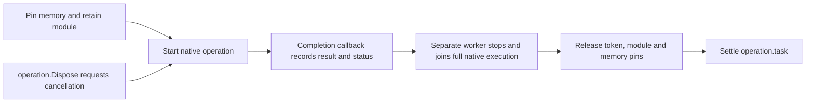

# Managed callbacks and native operations

BGCS keeps the exact callback ABI separate from its managed lifetime. A selected
named callback typedef can produce a standalone delegate declaration without
claiming that native code stops retaining its address. Set
`api.emitCallbackDelegates` to `false` to omit those standalone declarations;
raw imports keep their function-pointer signatures. A configured callback
wrapper still generates the handler type required by that wrapper.

## Synchronous callbacks

Declare the native lifetime, retention, threads and exception fallback:

```json
"semantics": {
  "callbackParameters": [{
    "function": "CallState",
    "parameter": "callback",
    "lifetime": "call",
    "retained": false,
    "threading": "callerThread",
    "userDataParameter": "state",
    "callableUserDataIndex": 1,
    "failureReturn": "-9"
  }]
}
```

For `int (*callback)(int value, void* state)`, the state slot becomes a generated
opaque token and the managed overload accepts `value => ...`. Static thunks
support AOT; tokens are not GC handles and are never reused. Without native user
data, the CoreCLR projection roots an exact reverse-call delegate through the
entire call. AOT profiles require the explicit user-data channel.

```csharp
int result = api.CallState(value => value + 11, 31);
```

The wrapper catches managed failures, returns the declared native fallback, and
rethrows the original failure after native code returns. Void callbacks omit
`failureReturn`; pointer results require the explicit string `"null"`. A native
Boolean callback uses its exact raw byte carrier. The callback can compose with
checked string, span and single-value conversions:

```csharp
int[] values = [1, 2];
int state = 10;
int result = api.CallComposed(value => value + 3, "AB", values,
    out int written, ref state);
```

An unchanged pointer argument remains visibly unsafe. A callback contract does
not infer that pointer's ownership, bounds or retention.

For a checked C++ scalar, void or owned-result status bridge, the callback
overload calls the existing status operation. Its native error cleanup completes
before the original managed callback failure is rethrown. If native code has
successfully created an owned result, the wrapper disposes that result before
throwing; a result-release failure is combined with the callback failure. Aliases,
named function views and the static facade forward to the same checked overload.

An owned C++ instance method can use the same callback projection when its exact
receiver matches a selected owned factory and preserves native const/volatile
qualifiers. The receiver must have an established borrowed call lifetime;
contradictory retention is rejected, and unknown receiver retention stays
unknown. The wrapper holds the receiver's resource lease through the complete
native frame. It does not declare that native code may retain the receiver after
return. Temporary buffers, pinned values and callback addresses separately need
their explicit nonretention contracts.

Both `widget.CallState(handler, value, fail)` and
`api.CallState(widget, handler, value, fail)` use one rooted callback address and
the same checked context. A foreign context is rejected. Owned results returned
by instance methods use the same adoption and release protocol as factories;
callback failure or invalid native output counts dispose an adopted result
before rethrowing. Self-disposal and concurrent disposal defer native object
release until the current native frame returns. A module-borrowed receiver does
not acquire this owned-receiver projection.

The local regression exercises all three imports with Runtime package/source,
including a static facade and single-file source output, on Windows x64 CoreCLR.
That evidence does not certify NativeAOT, browser Wasm or another operating
system; static reverse-call profiles still require explicit user-data and a
supported generated thunk.

## Returned-handle registrations

The returned-handle form requires a native factory returning a pointer
and a fixed `void StopAndJoin(Handle*)` export. The join must stop new calls and
wait for every complete native execution frame using the callback or state.

```json
{
  "function": "Register",
  "parameter": "callback",
  "lifetime": "registration",
  "retained": true,
  "threading": "anyThread",
  "userDataParameter": "state",
  "callableUserDataIndex": 1,
  "failureReturn": "-7",
  "unregisterFunction": "StopAndJoin",
  "unregisterQuiescence": "noActiveNativeInvocations",
  "registration": {
    "unregisterHandleParameter": "handle",
    "nullResultQuiescence": "noActiveNativeInvocations",
    "releaseThreadDomain": "any"
  }
}
```

These are explicit user assertions; generation does not promote them to
independently verified evidence. Null failure must leave no active native use.
Any-thread cleanup must be valid for the actual native library.

```csharp
using var registration = api.Register(value => value + 3, 0);
int result = registration.Invoke(handle => api.Raw.Trigger(handle, 38));
Exception? callbackFailure = registration.TakeCallbackException();
```

The state exists before the factory starts, so inline callbacks during
registration are supported. Disposing inside a callback dispatches shutdown
outside that callback. Public native uses drain before the native join; token
and module release follow the join. A failed join retains resources and exposes
`closeFailure` for a retry. `DisposeAsync` awaits shutdown on an allowed cleanup
thread; await it outside an active callback of that registration.

Closing the API context rejects new public calls while existing registrations
retain cleanup access. Unsafe external uses obtained through
`DangerousGetNativeHandle` must also obey the declared native shutdown protocol.
A browser profile that disallows synchronous native joins keeps the raw ABI and
reports why this owning projection is unavailable.

## Callback and user-data registrations

A library can instead identify its registration by the same callback address and
user-data pair, as in `bool Register(Callback callback, void* state)` and
`void StopAndJoin(Callback callback, void* state)`. Keep the callback lifetime,
threading, state slots and full unregister quiescence above, and replace the
`registration` object with:

```json
"registration": {
  "kind": "callbackAndUserData",
  "unregisterCallbackParameter": "callback",
  "unregisterUserDataParameter": "state",
  "successfulReturn": "1",
  "failureResultQuiescence": "noActiveNativeInvocations",
  "releaseThreadDomain": "any"
}
```

The generator freezes one native callback address and reuses that exact address
and non-reused state token for unregister, in the declared parameter order. A
void registration omits `successfulReturn`; a scalar registration supplies its
exact native successful value and guarantees that every other result leaves no
active native use. A returned pointer and pair identity are separate protocols;
the native async projection currently requires a returned operation handle.

The managed registration has the same `Dispose`, `DisposeAsync`, `completion`
and `TakeCallbackException` behavior. Its unsafe identity accessor is
`DangerousGetNativeUserData`, and `Invoke` receives that opaque `nint` token.
It is never a dereferenceable pointer to managed state. Native APIs that remove
future callbacks without waiting for complete active native frames do not meet
this owning protocol; their raw ABI remains available.

## Completion and cancellation

`semantics.asyncOperations` connects an operation-lifetime callback registration
to explicit result/status argument indices, success/cancellation values, an
optional cancellation export, and retained buffer identities. The generated
`StartAsync` returns `NativeOperation<TResult>`:

```csharp
using var operation = api.StartAsync(memory, mode: 0);
int result = await operation.task;
```

Operation-lifetime scalar buffers use `Memory<T>`. Their exact native element
bounds, null behavior and actual pinned-address alignment are checked before
the start call. Do not reuse the memory or dispose its backing owner until the
task completes.



A cancellation request does not release buffers or complete the task.
Acknowledged cancellation comes from the declared terminal native status. The
native completion callback can run before the start function returns; shutdown
waits until the returned handle is published. Completion callback entry alone
cannot prove that the native frame has stopped using memory or executable code.

See the executable fixtures
[call-scoped callbacks](../tests/BGCS.Tests/NativeCallScopedCallbackTests.cs),
[retained callbacks](../tests/BGCS.Tests/NativeRetainedCallbackTests.cs) and
[operations](../tests/BGCS.Tests/NativeAsyncOperationTests.cs). Their source is a
specification; platform certification still requires that revision's executed
receipts. Missing lifetime, quiescence or representation facts preserve the raw
ABI with a managed-projection omission diagnostic.

## Nonblocking event-loop shutdown

An event-loop registration explicitly declares `threading: "eventLoop"`,
`registration.releaseThreadDomain: "eventLoop"`, and
`registration.unregisterIsNonBlocking: true`. Native unregister must establish
`noActiveNativeInvocations` without waiting on the event-loop thread. These are
user assertions about the native library's protocol. A callback that can run on
arbitrary threads or an unregister operation that blocks does not qualify.

The generated factory captures `NativeCallbackDispatcher` before retaining
resources. Shutdown is queued after the current native frame, waits
asynchronously for handle publication and already-entered native uses, then
unregisters on the captured thread. `Dispose()` requests shutdown;
`await DisposeAsync()` waits for complete cleanup. Await outside the callback
being closed. Self-disposal is deferred, so native code can finish its call.
An injected dispatcher must enqueue onto that thread without running inline or
pumping inside an active native frame. Invalid queue/thread delivery fails
without executing native unregister.

Event-loop async cancellation additionally requires
`cancellationIsNonBlocking: true`. Cancellation remains a request. Pins, tokens
and module leases survive until native completion, the queued stop operation,
and managed invocation drain all finish. A native callback that reports a
result and then continues accessing its buffer is supported only through that
separate full-quiescence stop protocol.

The browser lifecycle fixture requires 33 checks in addition to the unchanged
74 raw invocation checks, separately in interpreter and AOT. Implementation and
desktop compilation alone do not establish browser certification; consult the
same-revision execution receipts.

The Browser Wasm profile uses an explicit wasm32 table-index transport for
direct function-pointer import parameters and results. Generated private
forwarders perform the checked address casts; the public raw API retains its
typed function pointers, including null and returned-callback values. This
capability requires the static native module adapter and its known 32-bit,
little-endian C calling ABI. It does not establish aggregate by-value calling
support, and a custom runtime profile must explicitly declare this capability.
