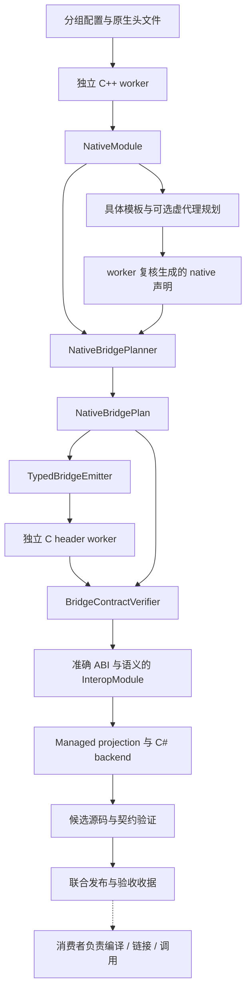

# 中立 C++ Lowering 架构

[English](lowering.md) | [实战手册](cpp-extension-cookbook.cn.md) | [架构](architecture.cn.md) | [原生输入](native-source-inputs.cn.md)

C++ backend 接收独立的原生事实，产生类型化 C ABI 操作。标准插件仅引用 `BGCS.Core`；解析器和 worker 执行属于其他层。

## 模型边界

| 模型 | 职责 |
| --- | --- |
| `NativeModule` | 原声明、类型、布局、模板、来源和目标事实 |
| `NativeBridgePlan` | C 载体、原生操作、参数转换、异常与释放协议 |
| `InteropModule` | 独立重新解析的准确 C ABI 与恢复后的语义 |
| `ManagedApiModel` | 托管公开 API 和显式转换 |
| C# emission plan | 具体导入、清理、Runtime 依赖和文件 |

标准模型不保存 Clang cursor、native handle、Roslyn node、打开的文件、服务或可变配置。专有 frontend contributor 在 worker 内执行，并输出中立事实。

## 扩展注册

`INativeTypeLowering` 接收 `NativeTypeView`、`LoweringContext`，返回 `NativeTypeLoweringPlan`。完整类型图必须包含主载体与所有输入形状。`INativeCallableLowering` 接收准确的 `NativeDeclaration`，返回完整 `NativeCallableLoweringPlan`。

注册表冻结后不允许重复 ID。优先级降序，同级稳定 ID 排序，同级独占匹配冲突失败。默认服务实例属于 generation session；匹配和规划期间都验证服务 ID/priority 未变化。

所有影响输出的服务提供实现、配置、私有状态和外部输入指纹。无法完整提供时关闭受影响缓存。SDK 直接注册和 manifest 插件使用同一规则。

## 类型化参数组

普通输入与原生参数保持一对一。展开输入使用 `BridgeArgumentGroup`，包含准确原生参数声明/类型 ID、命名 C carrier binding 和有内容指纹的表达式。组顺序与原参数一致，所有 C 输入被完整且不重复地使用。普通单载体组可以省略额外表达式。

验证器拒绝缺失、重复、无关或乱序绑定；emitter 只替换声明的名称，生成一次原生调用，该调用由消费者编译的 bridge 执行。参数组不能推断所有权或托管 pinning 协议。声明式入口为 `bridge.typeLowerings[].abiParameters`，完整配置见实战手册。

有限标准序列适配使用 `BridgeArgumentGroup.standardSequence`，无需拼接 source-expression 模板。模型保存准确元素类型、编译器 extent、复制/借用操作和证据。新增导出通过 `inputAdapterOf` 关联保留的原导出；生成前检查完整 data/length 覆盖与不变的结果身份。结果仅限标量/void，或具备完整析构配对和 creating-call 清理证明的新建拥有型默认标准 `basic_string`/`filesystem::path` 值。此适配器仍不接受借用、pointer/reference、自定义文本及其他容器结果，也不处理构造和自定义调用/结果表达式。`bridge.cpp.sequenceInputAdapters` 配置和明确的借用限制见实战手册。

## 操作、所有权与异常

类型化操作覆盖自由函数、静态/实例方法、构造、析构、原生 base cast、checked derived cast 和有限 STL 协议。受控表达式作为明确扩展，不取代整个操作模型。

`DefaultConstruct` 关联准确 owner，不伪造源函数。规划前必须有可空的编译器默认构造事实；未知、不可访问、已删除、抽象或不完整类型不提供该构造。生成源码包含构造断言与 `new Owner()`，由消费者编译器检查。BGCS 不编译或执行该构造；解析事实不能证明消费者构建或实际调用已经通过。

拥有型结果必须有准确的 native destruction 配对。生成释放要求析构不抛异常，但不因此证明线程无关。普通借用指针/引用结果保留未知生命周期；类型化同对象基类转换保留 owner 关系。按值 unique_ptr 参数移动内部所有权，调用方仍拥有变空后的 holder。

C++ 异常留在 status/error 边界内。拥有型错误对象有准确的 message/release 协议。用户源码断言保持 `UserAsserted`，不会因为编译通过自动升级为 `Verified`。

检查过的 C++ 标量 `bool` 保留 raw `uint8_t` ABI，friendly 值映射为 C# `bool`。输入转换为零或一，规范化的原生输出转换回逻辑值。该行为只来自准确的原 bool 事实与有限标量桥接转换，显式 managed recipe 优先。bool buffer 和无关整数别名不会因为宽度相同获得 bool 映射。

C++ `char8_t`、`char16_t` 与 `char32_t` 保留不同的原生基础类型身份、编译器大小和对齐，以及语言规定的无符号语义。复制的 `std::u8string` 序列输入使用 byte code unit，保留内嵌零，不自动解释文本内容。不同字符类型的借用 span 需要另行证明载体兼容，不能仅凭元素宽度相同复用整数 span。

## 标准库与平台事实

字符串、容器、optional/variant/expected、path、chrono、smart pointer 使用 opaque holder 与有限检查操作。`vector<bool>` 复制规范化元素，path 明确提取 UTF-8；普通字符串编码和 buffer 保留需要额外语义。

`bridge.cpp.familyBindings` 可以显式匹配准确的自定义 String、Vector、Span、Array、Optional、Map、Set、Expected、
UniquePointer、SharedPointer、Variant、Path、Duration 和 TimePoint。
自定义 variant 必须显式声明 member-template 访问，path 必须声明 GenericUtf8 或 NativeUtf8；chrono
保留原生表示、ratio 和 clock 身份。
这些绑定复用类型化操作与独立验证流程，同时保留实际 C++ 类型。原生形状检查不会提升
用户对行为、所有权或编码的断言等级。完整配置与限制见实战手册；任意替换模板族名称
不能证明存储兼容。

标准字符串的准确命名别名可以分别声明编码：例如 `nativeType: "std::string"` 配
`stringEncoding: "utf8"`，`std::u16string` 配 `utf16`，`std::u32string` 配 `utf32`。
实际 canonical specialization 和 code-unit 参数仍取自编译器；同一 owner 的第二个别名策略或
冲突的模板级策略会失败。自定义模板的命名别名仍需模板族协议，不会自动获得标准库行为。

`NativeValueProtocol.scopedRelease` 默认不授予能力。有限的 `CreatingCall` 只允许新建的默认
allocator 标准字符串或 filesystem path 在同一次同步创建调用、同一调用线程中复制并析构。
生成的断言在消费者编译 bridge 时检查准确类型身份和非抛出析构；自定义 traits、allocator 与 `pmr` 保留未知清理契约。
`CopyCodeUnits` 接收准确的可写单元指针和容量，经 status 边界返回完整写入单元数；写入前检查
容量、空地址和对齐，每次复制只转换一次 path。该能力不授予逃逸 handle、finalizer、跨线程或借用视图生命周期。

拥有型 C++ receiver 的原生地址是稳定对象地址，与临时编码输入存储不同。生成一个成员调用
不能证明成员函数体不保留 `this`；没有明确依据时该事实保持未知。拥有型 wrapper 在完整原生
操作中保留对象和模块；返回后的原生保留仍需对象自身规定的协调与析构协议。文本 receiver
便利层必须关联准确的拥有型 wrapper 和 context，不能给原始指针制造不保留断言。

模型保留编译器 canonical record spelling 和 unsigned integral template 值。emitter 重建带完整 namespace 的指针/引用和各层限定符，按目标指针宽度解析 native-size 载体。大小相同或目标名称相似不能证明 ABI 正确。

虚代理元数据记录 status-return Cdecl slot，生成声明在 factory 导出前重新解析。原始 slot 地址由调用方维持生命周期；托管长期回调包装还需可靠结束协议与正在执行的调用跟踪。

## 验证与发布

写候选前检查源身份、arity、载体、释放配对、source fragment 和参数组。C header reparse 复核准确的导出集合与签名，语义合并保留原生参数 ID 和证据等级。

BGCS 在发布前验证源码和契约，不编译托管消费工程、不链接原生代码，也不调用生成的 API。生成验证失败会阻止发布。`bridge.module.json` 保存类型化计划；类型化 `NativeSourceManifest` 仍位于 `<target>/metadata/native-source.manifest.json`。通过 `GenerationResult.nativeSources` 或验证后的 `BindingArtifactManifest.ReadNativeSources` 读取，再按[输入说明](native-source-inputs.cn.md)映射根目录。verification 元数据记录生成器阶段，不表示消费者后续构建已经完成。

有限 value protocol 的原生操作与高层托管投影有各自的仓库消费夹具。容器 raw/status 检查不能证明自动返回 C# 数组。计数字符串参数保留准确的 data/length 文本契约。文本夹具覆盖 CStr 输入、新建默认标准字符串/path 复制为 C# `string`，以及 `SetNameWithSequence(string)`、`GetName()`、`PrefixWithSequence(string)` 等拥有型成员；原生函数体可以保留 `this` 直至析构，不把未知 self 保留事实改成 false。这些外部夹具执行与源码生成、版本认证是独立步骤。chrono 保留原生 count、ratio、clock，不能默认把任意时钟当成托管日期的 epoch。
