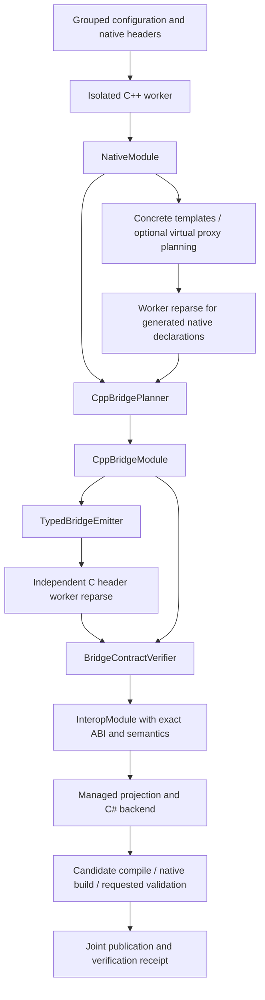

# Neutral C++ lowering architecture

[简体中文](lowering.cn.md) | [Cookbook](cpp-extension-cookbook.md) | [Architecture](architecture.md)

The C++ backend accepts detached native facts and produces typed C ABI operations. Standard plugins reference `BGCS.Contracts`; parsing and worker execution stay outside the lowering layer.

## Model boundaries

| Model | Responsibility |
| --- | --- |
| `NativeModule` | Original declarations, types, layouts, templates, source identities, target facts |
| `CppBridgeModule` | C carriers, source actions, argument/result conversions, exception/release protocols |
| `InteropModule` | Independently reparsed C ABI enriched with original semantics |
| `ManagedApiModel` | Public managed API and explicit conversions |
| C# emission plan | Concrete imports, cleanup, runtime dependencies, files |

No standard model contains Clang cursors, native handles, Roslyn nodes, open files, services, or mutable configuration. Frontend-specific contributors execute in the worker and publish neutral facts.

## Ports and registration

`ICppTypeLowering` receives `NativeTypeView` and `LoweringContext`, then returns `CppTypeLoweringPlan`. Its complete type graph includes the primary carrier and every referenced input shape. `ICppCallableLowering` receives the exact `NativeDeclaration` and returns a complete `CppCallableLoweringPlan`.

Frozen registration rejects duplicate identities. Priority descends; stable ID orders a tier; competing exclusive matches within that tier fail. Session factories own their service instances. Both matching and planning verify that service IDs/priorities have not changed.

All services affecting output contribute implementation/configuration/private-state/external-input fingerprints. Missing complete fingerprints disable the affected cache. This rule applies equally to embedded SDK services and manifest-loaded plugins.

## Typed argument groups

Ordinary C inputs preserve one original native parameter each. An expanded parameter uses `BridgeArgumentGroup`, with exact original declaration/type IDs, named C carrier bindings, and a fingerprinted expression. Groups preserve native parameter order and consume every exported C carrier exactly once. A one-carrier ordinary group needs no new expression.

The verifier rejects missing, duplicate, unrelated, or out-of-order bindings. The emitter substitutes only declared names and invokes the native callable once. A group cannot infer ownership or a managed pinning protocol. The recipe form is `cpp.typeLowerings[].abiParameters`; the cookbook contains complete examples.

Finite standard sequence adapters use `BridgeArgumentGroup.standardSequence` instead of a source-expression template. The model records the exact original element, compiler extent, copy/borrow operation, and evidence. Additional exports link to a preserved primary through `inputAdapterOf`; exact data/length coverage and unchanged result identity are checked before emission. Results are limited to scalar/void or a fresh owned default-standard `basic_string`/`filesystem::path` value with its complete destruction pair and creating-call cleanup proof. Borrowed, pointer/reference, custom-text and other container results remain unavailable through this adapter, as do construction and custom invocation/result expressions. See the cookbook for `cpp.sequenceInputAdapters` and its explicit borrowing constraints.

## Operations, ownership, and errors

Structured operations cover free/static/member calls, construction, destruction, native base casts, checked derived casts, and finite standard value protocols. Controlled expressions provide explicit extensions rather than replacing the whole operation model.

`DefaultConstruct` names an exact owner without creating a fake source function. A nullable compiler-evaluated default-constructibility fact is required before planning it; missing, inaccessible, deleted, abstract and incomplete construction remains unavailable. A final native compiler assertion and `new Owner()` validate the actual build arguments. `generate` retains the pending native-compilation stage; parser facts alone do not certify native build or invocation.

Owned result plans require the exact native destruction pair. Generated releases require nonthrowing destruction; this does not prove thread independence. Arbitrary borrowed pointer/reference lifetimes remain unknown. Typed same-object base casts retain the owner relation. A by-value unique-pointer argument moves its payload while retaining caller ownership of its now-empty holder.

C++ exceptions stay inside the status/error boundary. The owned error object has a defined message/release protocol. User native source assertions stay `UserAsserted`; they do not become `Verified` simply because source or imports compile.

Checked C++ scalar `bool` conversions retain a raw `uint8_t` ABI and project friendly values to C# `bool`. Input converts to zero or one and normalized native output converts back to a logical value. This derives only from exact original bool facts and the finite scalar bridge conversion; explicit managed recipes take precedence. Bool buffers and unrelated integral aliases do not acquire a boolean projection from width alone.

C++ `char8_t`, `char16_t`, and `char32_t` retain distinct native primitive identities, compiler sizes and alignments, and their unsigned language semantics. Copied `std::u8string` sequence inputs use byte code units without interpreting the contents or losing embedded zeros. Borrowed spans of distinct character types require a separate proven carrier and cannot reuse an integer span merely because its element width matches.

## Standards and platform facts

Standard values use opaque holders and finite checked operations for strings, containers, optional/variant/expected, paths, chrono, and smart pointers. `vector<bool>` copies normalized elements. Paths use explicit UTF-8 extraction. General string encoding and buffer retention require semantic contracts.

`cpp.familyBindings` offers exact opt-in custom template matching for String, Vector,
Span, Array, Optional, Map, Set, Expected, UniquePointer, SharedPointer, Variant,
Path, Duration and TimePoint. Custom variants require explicit member-template access;
custom paths require explicit GenericUtf8 or NativeUtf8 conversion. Chrono keeps native representation,
ratio and clock identity. It reuses the typed operation and independent verification
path while preserving the actual C++ type. Native shape checks do not upgrade the
user's behavioral, ownership or encoding assertions. See the cookbook for complete
configuration and limits; arbitrary family-name substitution is not a storage proof.

Exact named standard string aliases can declare independent encodings: for example,
`nativeType: "std::string"` with `stringEncoding: "utf8"`, `std::u16string` with
`utf16`, and `std::u32string` with `utf32`. The actual canonical specialization and
code-unit argument still come from the compiler. A second alias of the same owner,
or a competing template-wide policy, is rejected. Named custom template aliases
continue to require a template-family protocol rather than acquiring standard behavior.

`NativeValueProtocol.scopedRelease` has no capability by default. Its finite
`CreatingCall` scope permits only a fresh default-allocator standard string or
filesystem path to be copied and destroyed inside the same synchronous creating
call and caller thread. Native identity and nonthrowing destruction are asserted
by the actual compiler; custom traits, allocators and `pmr` retain unknown cleanup.
`CopyCodeUnits` copies the complete counted extent into an exact writable unit
pointer/capacity pair and returns the written count through the status boundary.
It checks bounds, null and alignment before writing, and converts a path once per
copy. This grants no escaping handle, finalizer, cross-thread or borrowed-view lifetime.

An owned C++ receiver has a stable native address distinct from temporary encoded
input storage. A generated member call cannot prove that its body never retains
`this`. That fact stays unknown unless explicitly established. The owning wrapper
retains the object and module through the full native operation; retention beyond
return still requires the native object's documented coordination and destruction
protocol. A text receiver convenience must attach to that exact owning wrapper
and context rather than manufacturing a nonretention claim for a raw pointer.

Compiler-provided canonical record spellings and unsigned integral template values are preserved. Source emission reconstructs globally qualified nested pointer/reference names and qualifiers. Target pointer width resolves native-size carriers. The emitter does not infer ABI compatibility from equal sizes or target-name substrings.

Virtual proxy metadata records exact status-returning Cdecl callback slots. The generated declaration is reparsed before its factory becomes callable. Raw slot addresses require caller-managed lifetime; safe retained managed adapters need a proven shutdown and in-flight invocation protocol.

## Validation and publication

Before writing candidates, operation verification checks source identities, arity, carriers, ownership pairs, fragments, and argument groups. C header reparse checks the actual export set and signature shapes. Semantic merging preserves original parameter identities and assertion levels.

Requested managed compilation, native linking, export verification, and invocation run against candidates. Failure does not publish a successful formal result. Generated typed plans live in `bridge.module.json`; native build inputs live in `bridge.manifest.json`. The verification receipt records which stages actually ran.

Native value operations and high-level managed projections are verified separately. Raw/status container tests do not establish automatic C# array returns. Counted string inputs retain their exact data/length text contract. Local Windows/CoreCLR invocation evidence covers minimal CStr string inputs, fresh default-standard string/path copies to C# `string`, and owned members combining counted inputs with text results across all three imports and both Runtime modes. The owned fixture uses `SetNameWithSequence(string)`, `GetName()` and `PrefixWithSequence(string)`; its native body really retains `this` until destruction, without changing unknown self retention to false. These local checks do not certify other platforms, NativeAOT or final packages. Chrono preserves native count, ratio and clock rather than assuming a managed date epoch.
