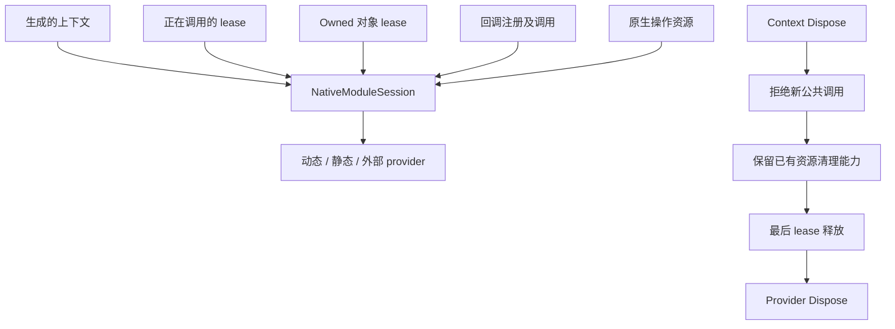

# Runtime 生命周期

[文档](README.cn.md) · [English](runtime-lifetime.md) · [ABI 安全](abi-safety.cn.md)

`BGCS.Runtime` 支持原生调用，不依赖生成器或解析器。资源机制不会推断原生库的所有权、unregister 保证或异步完成协议；这些事实必须来自明确的原生契约。

## 模块会话与 lease

会话初始持有一个上下文引用。`AcquireCall()` 为公共调用保留模块，`AcquireResource()` 为原生资源保留模块。关闭上下文释放自身引用并拒绝新公共调用；已有资源的 `AcquireCleanupCall()` 仍可在关闭后保护析构。普通资源操作在上下文关闭后仍被拒绝。最后引用释放后才 Dispose provider。

`NativeModuleSession.Dispose()` 启动关闭，不等待资源。`DisposeAsync()` 还等待最后释放并报告 provider 卸载失败。等待会话之前应先释放 owned 对象/注册，否则会等待自己仍持有的 lease。`unloadFailure` 记录失败，不表示卸载已成功。

会话构造时以 GC handle root provider，避免 GC 在 session 能关闭它之前就把自定义 provider 加入 finalizer 队列。取得第一个原生 resource lease 时，同一个预留 root 改为保留 session。上下文仍开放时，最后一个成功 resource lease 释放会把 target 恢复为 provider，让 session 本身能够正常进入 finalizer。若希望遗弃的 session 自动清理，自定义 provider 不应反向保留所属 session；该引用环会使 session 一直可达，必须显式调用 `Dispose()`。有未结束 lease 的关闭阶段及 provider 卸载期间同样保留 session。原生资源或 provider 的清理结果不确定时，即使用户对象已不可达，也继续 root session 与 provider，避免自定义 provider 的 `SafeHandle` finalizer 绕过尚未结束的 lease。session 不会 root owned handle，因此普通资源 finalizer 仍能执行清理。成功卸载 provider 后释放 root；不确定的终止失败会保留模块至进程结束，不自动重试可能已经执行的释放。已知的终止性资源释放失败会立即使正在等待或后续的 `DisposeAsync()` fault，同时保留 provider，避免 `await using` 因不可安全重试的释放而无限等待。

## Provider 与完整函数表

最后一个 lease 的释放线程同步调用 provider 的 `Dispose()`；遗弃上下文可能在 finalizer 线程到达这一边界。自定义 provider 必须支持实际清理线程，或要求调用者在其支持的线程上显式 drain。session 不会把 allocator 的线程域套用于模块卸载。返回代表 provider 声明的清理已完成；抛出则保留 provider，使 session 完成任务 fault，且不自动重试。

### 显式共享的静态 API

`api.style = "static"` 生成公共静态 facade，例如 `WidgetApi`，以及独立实例类型 `WidgetApiContext`。默认 `instance` 风格仍直接生成独立上下文。静态方法转发到同一套已规划的实例方法；字符串、buffer、错误和所有权转换不会另写一套。

FunctionTable 使用 `WidgetApi.Load(path)` 或 `FromProvider(provider)` 初始化共享上下文；静态导入使用 `Create()`，静态原生表使用支持的 `FromStatic()`。这些 facade 工厂返回 `void`，拥有共享上下文；独立实例工厂位于 `WidgetApiContext`，照常返回可释放实例。初始化前调用会失败。

只有候选上下文成功解析完整导出并通过布局检查后才替换共享上下文。失败保留上一实例；成功以原子操作安装新实例并关闭旧实例。并发替换与调用可能使尚未进入原生调用的旧实例操作收到 `ObjectDisposedException`；已取得 call lease 的调用可安全完成。旧对象保留其原上下文和清理 lease，替换后不允许继续普通操作，但仍可正确析构。

`Raw` 返回读取时那个实例的 raw 入口，不会让已保存的 raw 引用偷偷切换到另一实例。`IsInitialized` 只表示当前共享引用存在，不是并发调用的锁。`Dispose()` 清空并关闭当前引用；`DisposeAsync()` 清空、关闭并等待它捕获的当前实例。先释放该实例拥有的对象/注册，再等待关闭完成。之前已被替换或清空的实例由它们各自仍存在的 lease 完成清理。

需要精确控制多个库、长期会话或并发切换时，可同时使用多个 `WidgetApiContext` 实例；这些实例不参与静态 facade 的状态。拥有型对象的公开类型位于具体上下文内，例如 `WidgetApiContext.WidgetObject`。

| Provider | 所有权 |
| --- | --- |
| `DynamicModuleProvider` | 拥有动态库句柄并释放一次。 |
| `StaticModuleProvider` | 复制名称/地址；有明确 release action 时拥有释放责任，否则借用静态导出。 |
| `ExternalFunctionTableProvider` | 复制验证后的有序表，全部验证成功后才接收外部 lifetime lease。 |
| 自定义 `INativeModuleProvider` | 实现精确导出查询和自己的释放契约。 |

生成的动态 factory 使用消费者程序集参与原生资产与 AssemblyLoadContext 解析，不意味着拦截 `SetDllImportResolver`。自定义加载采用明确 provider factory。

必需导出一次解析成完整不可变集合，缺失或零地址在暴露半初始化表之前失败。外部表检查 ABI 身份字符串、精确长度、唯一名称和非零地址。身份声明不等于独立 ABI 证明；表生产者必须让全部地址在移交 lifetime 结束前有效。

[自定义函数表示例](../examples/CustomFunctionTable/README.cn.md) 适配带保留槽且 callable 顺序不同的七槽原生协议。消费者仅引用 Runtime，核对原始表长度与 ABI 身份，再把选定的名称和地址交给 `FromProvider`。真实生成消费者测试调用未导出的原生函数，拒绝无效及不完整函数表，并验证关闭上下文后，模块引用仍保留到活动原生调用从反向 callback 返回。槽位选择由明确的消费者适配器负责，不需要另一套生成器配置格式。

## Owned 与 Borrowed handle

`OwnedNativeHandle` 保留模块 lease 和匹配的释放 action/domain。`Invoke(...)` 同时保护 SafeHandle 与模块免受并发释放。`AsBorrowed()` 跟随 owner 的有效性，不获得析构责任，不能超出 owner 有效期。

析构采用 cleanup lease，因此上下文关闭后仍可释放对象。成功释放后才释放模块资源 lease。SafeHandle finalizer 捕获错误到 `releaseFailure`，不向外抛异常。失败时保留模块，不能当作释放成功；SafeHandle 不自动提供重试协议。分配器、释放函数和线程释放域必须对应。

生成 owning wrapper 需要支持的明确所有权/释放事实。raw pointer 或 Create/Destroy 名称本身不证明拥有关系。

`ModuleBorrowedNativeHandle` 是独立的 Runtime 原语，用于明确具有模块生命周期的借用地址。它接收一个 `NativeModuleLease`，不调用原生析构或 free。`Invoke(...)` 在同步调用期间同时保护引用和模块。关闭上下文后拒绝新调用，已开始的调用结束前，引用的释放不能放弃该 lease。Dispose 与 SafeHandle finalizer 只释放这个 lease；模块 provider 的卸载失败仍可通过 `NativeModuleSession.unloadFailure` 和 `DisposeAsync()` 观察。

原生协议必须独立保证地址一直有效到真正卸载模块。保留库不能延长已被 native 提前销毁或替换的其他对象的生命周期。零地址产生无效引用并立即释放接收的 lease；null lease 在转移前失败。源码功能 `handles.module-borrowed` 选择相同 Runtime 实现及完整依赖闭包。

生成器通过 `semantics.borrowedResults` 和显式 `"lifetime": "module"` 接入这一协议。该保证保持 `UserAsserted` 来源。`api.memberFunctions[].kind = "moduleBorrowed"` 选择相同原生记录或 opaque alias 身份的借用对象；成员接收参数仍需显式 borrowed、非保留的 `call` 契约。

借用 wrapper 提供 `Dispose`、`isClosed` 和受保护的成员调用。Dispose 仅释放模块 lease；它没有原生析构、allocator domain 或拥有型 `AsBorrowed()` 操作。函数别名、容器和有限默认参数继续转发到同一操作。getter 返回 null 时明确报错；检查库自身的空结果协议时使用 `Raw`。

首个类型化协议覆盖同步原生指针 getter 和标量/void 成员。owner/call 生命周期、可提前替换的全局对象需要各自的有效性协议。冲突的释放声明、丢失原生 const/volatile、跨上下文参数和未支持输入会失败或只保留 raw。上下文关闭后拒绝新调用，已开始的调用保留模块直到返回。

生成的 ABI 存储 struct 保持 `partial`，用户可以在其他文件添加方法。新增实例存储仍必须满足原生布局；partial 不会赋予额外按值 ABI 能力。

## Callback registration

`CallbackRegistration` 拥有非零静态 thunk 或明确保留的 callback pointer，可同时保留状态和模块 lease。支持时 `CallbackRegistration<TDelegate>` 保留 delegate。

原生 unregister 返回前必须禁止新的 callback 开始，并同步可能超出模块 lifetime 的原生执行。thunk 使用 `TryEnterInvocation(...)`，在 `finally` 释放 invocation lease。默认 `CallbackShutdownOrder.CloseBeforeUnregister` 在请求关闭时拒绝新 entry。显式 `KeepOpenUntilUnregistered` 在原生 stop-and-join 执行期间继续接纳合法回调，收到成功确认后才关闭接纳；失败则保留回调能力、状态和模块以便重试。两者都要求成功 unregister 且全部已开始调用结束后才最终清理。`isClosing` 表示已请求关闭，不替代所选策略的回调接纳检查。

`CallbackRegistry<TState>` 为静态 AOT thunk 保存受托管根保护的状态，并提供非零、不复用的 user-data token。thunk 通过 `TryGet` 查找状态，已退役的 token 返回失败，不解引用已经释放的 `GCHandle`。token 注册只能在原生停止并等待完成后释放。这个查找机制不能保护已经释放的原生 proxy/vtable；销毁虚接口代理前，仍须确认整个原生调用栈已退出，而不只是托管 thunk 已返回。

回调内释放自身注册时，unregister 转到回调线程之外，允许原生 stop/join 等待当前回调返回。unregister 失败保留资源并记录 `closeFailure`，后续 disposal 可以重试。`DisposeAsync()` 必须在该注册的活动 invocation **之外**等待；回调等待自己 drain 会形成依赖环。浏览器/单线程环境应采用不阻塞完成所需执行的异步协议。

`CallbackExceptionBoundary` 使用每实例有界队列捕获托管异常并返回明确 fallback。异常不能穿越 reverse native 边界。AOT 采用静态 thunk，不假定所有运行时支持动态 delegate。

Runtime registration 和 raw callback ABI 能力，不等于自动生成任意 retained callback/event wrapper。生成覆盖以功能 inventory 和真实收据为准；生成器不会猜任意 unregister 保证。

### C++ 虚接口的生成注册

`cpp.virtualCallbacks` 显式选择抽象接口。默认 `releaseThreadDomain = "unknown"` 保留经过复核的 raw 构造、析构、base cast 和 callback typedef；缺少释放线程依据时省略托管注册并报告原因。显式声明 `releaseThreadDomain = "any"` 是调用者断言，证据保持 `UserAsserted`，不会变成 `Verified`。

例如选择 ID `calculator` 后，具体上下文包含 `ICalculatorCallbacks`、`CalculatorCallbackRegistration`、`CreateCalculatorCallbacks(target, stopAndJoinNative)` 和 `WithCalculatorCallbacks(target, operation)`。静态 API facade 转发到同一实例实现。静态 AOT thunk 使用精确的 Cdecl 参数与结果指针，支持已检查的标量和 bool 转换；原生引用或对象地址以借用的 `nint` 表示，不延长原对象生命周期。

创建注册必须提供 `Action<nint>`：其返回表示原生已禁止并等待完**所有使用该接口的原生执行**。注册的 `Invoke` 保留模块和 proxy，并与停止操作协调；`DangerousGetNativeInterface` 只借用地址，外部使用必须受同一停止协议约束。上下文关闭后禁止新的公开 `Invoke`，已有回调仍保留清理能力。析构在成功 stop-and-join 与活动托管 invocation 排空后执行。停止失败保留状态与模块，`closeFailure` 可读取并允许重试。停止 action 自己也必须具有上下文关闭后仍可工作的清理域，不能假定已关闭上下文的普通 raw 调用仍会被接纳。

`WithCalculatorCallbacks` 只用于一个同步、非保留调用：operation 返回之前，全部原生使用必须结束。返回一个尚未完成的 Task 不符合这个契约。注册没有自动推断该事实；该入口是明确的调用者生命周期断言。回调内自我释放会推迟停止和析构，避免等待自身原生栈返回。

托管异常被捕获到注册的 `TakeCallbackException()`；native proxy 以非零 callback status 触发 C++ 异常。BGCS 导出边界会把它转换成原生 error channel。直接从第三方原生线程调用接口时，该调用者必须捕获 C++ 异常，或提供明确的 native fallback adapter。当前非抛出接口不使用这一策略。Windows CoreCLR 的六组 imports × package/source 真实调用已覆盖这些机制；其他平台与 NativeAOT 的同类生成注册仍须独立验收。

## 原生异步操作

`NativeOperation<TResult>` 接收并拥有复制的 lifetime 序列，例如 pin、回调注册、handle 和模块 lease。第一个 `TrySetResult`、`TrySetException` 或 `TrySetCanceled` 获得 terminal 所有权；逆序释放资源后才完成 `task`。清理失败使 task fault，多次 terminal 不重复释放。

`Dispose()` 请求原生取消，但继续保留资源。`DisposeAsync()` 请求取消并等待 terminal 确认。请求取消**不等于**原生已停止访问 buffer。只有原生协议确认不再访问资源后才能调用 terminal 方法。没有确认时不能凭等待时间虚构完成。存在该 Runtime 机制，不表示任意 C API 已自动生成 Task wrapper。

## 字符串、buffer 与对齐

临时 friendly 字符串使用严格 UTF-8/UTF-16/UTF-32 codec 和 `NativeStringLease`，只用于明确不保留地址的调用。null、终止、code-unit 宽度/字节序和 lifetime 必须一致。lease 随调用结束；原生拥有的返回字符串需要自己的分配/释放协议。

Pinned span 要求明确同步调用、bounds、direction、null 与不保留地址。原生不能在 fixed 范围后保存指针。不能把独立 capacity 协议或异步保留地址推断成安全 Span。

`NativeAlignedBuffer` 配对 aligned allocation/free，alignment 必须是至少满足指针对齐的二次幂。address 借用到 Dispose 为止，并发使用需调用者同步。地址对齐正确仍不证明按值 ABI。

## 自定义分配与配对释放

`NativeAllocator` 同时保留实际分配、释放回调、不可变 `allocatorId`、必须明确选择的 `NativeAllocatorThreadDomain`，以及可选模块 session。释放域名称字符串不会自动提供分配器实现。`Allocate(logicalLength, alignment)` 检查正二次幂对齐，按溢出检查得到非零且取整的实际分配长度，并验证返回地址。返回的 `NativeBuffer` 永久绑定同一释放回调，释放时传回完全相同的实际长度与对齐。

通过 `buffer.Invoke((address, logicalLength) => ...)` 访问内存，可以防止并发 Dispose 在调用期间释放它；有模块时同时保留 call lease。关闭模块后拒绝新分配与公共 buffer 操作，但现存分配仍保留模块以执行匹配 cleanup。原生分配器 context 可以绑定模块 provider 的最终释放回调，等全部 buffer 释放后再销毁。没有额外 lifetime 协议时，不能把借用地址保留到 Invoke 之外。

`AnyThread` 是调用者明确断言：分配、释放回调支持任意并发线程，包括 finalizer。`Dispatcher` 要求提供 `INativeReleaseDispatcher`；分配与访问必须满足 `CheckAccess`，异线程 Dispose 经 `Post` 排队。dispatcher 必须保留 action，并最终在允许线程执行。`Dispose` 立即拒绝新访问；`DisposeAsync` 等待正在进行的访问和实际释放结束。必须保持 dispatcher 存活并持续处理队列，直到异步释放完成，finalizer 不会同步等待它。

释放回调抛异常时，原生 free 可能已经执行，不能猜测是否仍然拥有资源。Runtime 保存 `releaseFailure`，让 `DisposeAsync` 失败并保留模块 lease，绝不自动重试任意 free，也不把失败当作成功。允许恢复的原生释放需要自己的明确状态协议；dispatcher 没有执行 action 也不能被当成释放完成的证据。

[自定义分配器示例](../examples/CustomAllocator/README.md) 使用实际每实例原生状态，拒绝错误 owner/长度，验证原生 checksum，并在 buffer 存活时关闭上下文。`RuntimeSourceCatalog` 的 `memory.native-allocator` 功能选择相同源码实现。这是消费者分配抽象，不会悄悄更换临时字符串分配器，也不等于已实现全部生成参数的分配协议。

严格输入 codec 还提供显式 allocator 重载：`Utf8Codec.EncodeNullTerminated(text, allowsNull, alignment, allocator)`；UTF-16/UTF-32 则为 `EncodeNullTerminated(text, allowsNull, bigEndian, alignment, allocator)`。省略 allocator 时继续使用框架分配。文本校验先于分配，`NativeStringLease` 保留真实配对及模块直到匹配释放。`Dispose()` 关闭访问并报告已知的立即释放失败；`DisposeAsync()` 还等待实际线程亲和 free，失败时 fault。finalizer 不抛异常、不阻塞等待 dispatcher。`pointer` 是借用地址，调用者必须维持 lease 与原生调用生命周期并协调并发 Dispose。codec 源码功能会选择同一 allocator 依赖闭包。

具有文本输入的生成上下文在常规 `Load`、`FromProvider`、`Create` 或 `FromStatic` factory 上提供可选 `temporaryAllocatorFactory`。回调接收该实例的精确 `NativeModuleSession`，返回构造时绑定同一 session 的 `NativeAllocator`。返回 null、绑定其他 session 或未绑定都使初始化失败并关闭候选 session。回调只在完整导入表和存储 guard 通过后运行，分配器随实例冻结；省略时继续使用框架分配。显式静态 facade 转发同一 factory。分配／释放回调应捕获独立检查过的原生地址，确保上下文关闭后仍可清理，不能依赖已经关闭的 `api.Raw`。原生 allocator state 必须保留至全部相关 buffer/text lease 完成释放。

## 显式 C 所有权与成员展示

直接返回 C 指针的 factory 可以通过 `semantics.ownedResults` 声明精确释放函数、分配／释放域，以及 `releaseThreadDomain: "any"`。当前自动路径要求同步指针返回和精确的 `void(T*)` 释放 ABI，释放参数不能混入其他协议。生成代码在创建前保留模块 resource lease，拒绝 null 结果，并在安装拥有型 handle 失败时清理已取得的原生指针。不支持的所有权便利包装保留正确 raw ABI，同时报告 `BGCS-FRIENDLY-OMITTED`；整数 handle 或返回状态的析构需要显式受支持的 adapter。这些配置仍是 `UserAsserted`，不会被标成独立原生验证。

`api.memberFunctions` 独立选择精确 C 函数、receiver 参数和原生 record／命名 opaque 指针别名。receiver 还需要 `semantics.borrowedParameters` 中显式的 `lifetime: "call"` 与 `retainsPointer: false`。展示规则不会把自由函数伪造成 C++ 源码成员。匹配的受支持 factory 产生指定拥有型对象；对象方法通过 handle 的 call/resource 生命周期调用，类型化上下文 facade 拒绝其他上下文创建的对象。成员可用 `releaseDomain` 进一步限制到声明的原生分配／释放域。两个互不相关的 `void*` 别名不能证明同一对象身份；自行维护原生协议时仍可使用 Raw。

别名、函数视图、默认参数和显式共享静态 API 转发同一套已检查的上下文签名。关闭上下文会拒绝新的普通对象调用，匹配的对象析构仍能在 resource lease 释放前执行。这不会让原生对象自动线程安全，也不会证明其应用级同步协议。

## 包/源码与验收

`runtime.mode = "package"` 引用 Runtime；`source` 在 API 局部 namespace 选择源码闭包，单文件也可合入。两种模式遵循相同支持语义，源码模式不会给消费者增加生成器依赖。

Runtime 测试覆盖模块 drain、并发 handle、unregister 失败/重试/自身关闭、异常边界、取消/terminal 竞争、严格文本和分配。独立 NativeAOT/浏览器 fixture 还实际调用原生 callback、对象与函数表失败路径；这些证据不能扩大为其他平台的自动认证。生成的同步回调、返回 handle 注册与 callback/user-data 成对注册复用同一 Runtime 协议；显式终态操作增加内存 pin，并在完成 task 前另行 join 完整 native 执行。同步 join 投影要求运行时允许阻塞的 native 清理。精确契约与当前支持的 factory 形状见[回调实战手册](callbacks.cn.md)。另见[测试](testing.cn.md)、[ABI 安全](abi-safety.cn.md)及[功能 inventory](../eng/acceptance/feature-inventory.json)，认证必须注明目标、运行时、导入与 source revision。

## 明确的原生模块所有权

`DynamicModuleProvider.FromHandle(handle, ownsHandle: true)` 在构造成功后接管一个
已加载的平台模块引用；`ownsHandle: false` 只借用，外部 owner 必须让模块存活到
provider/session 的全部使用结束。零 handle 在所有权转移前被拒绝。
provider 的符号查找与释放互斥，取得的地址不会延长模块生命；调用期间需要 session
call lease 或等效的原生生命周期同步。

名称／路径解析和自定义符号源可以按每个 provider 独立组合，再传入生成的
`FromProvider` factory，不需要进程全局加载拦截器。空静态符号源使用
`new StaticModuleProvider([])`。

必需函数表只在所有必需符号解析成功后冻结。修改布局时创建另一套完整 provider，
已有调用继续使用原来的表，不安装半初始化或零地址 callable slot。
带保留槽的 native 表使用 [Runtime-only 槽位 adapter](../examples/CustomFunctionTable/README.cn.md)，
复制检查后的必需地址，并保留所提供的模块生命周期。

## 复制原生字符串返回值

`semantics.stringResults` 把明确的 UTF-8／UTF-16／UTF-32 长度协议与独立的 owned 或 module-borrowed
返回契约组合。包装在原生返回、严格解码、匹配释放整个阶段持有一个 call lease。
owned 结果通过 `finally` 调用精确独立的 `void(T*)`，Unicode、null、长度和转换失败也执行释放；
临时输入文本保留自己的 allocator 配对。module-borrowed 结果在 call lease 结束前完成复制，不虚构释放函数。

Runtime 提供零终止 `Decode(address, maximumCodeUnits, ...)` 与精确长度
`DecodeLength(address, codeUnitCount, ...)`，后者保留内嵌 NUL。逐 code-unit 的 volatile 扫描在第一个
终止符立即停止，再建立实际长度的 span；扫描上限较大也不会为了查找终止符而进行跨 guard page 的向量读取。
原生契约仍须保证地址至少有效到终止符或精确长度；托管范围检查不能证明任意原生地址可读。
完整配置见[配置指南](configuration-guide.cn.md#显式原生字符串返回值)。
