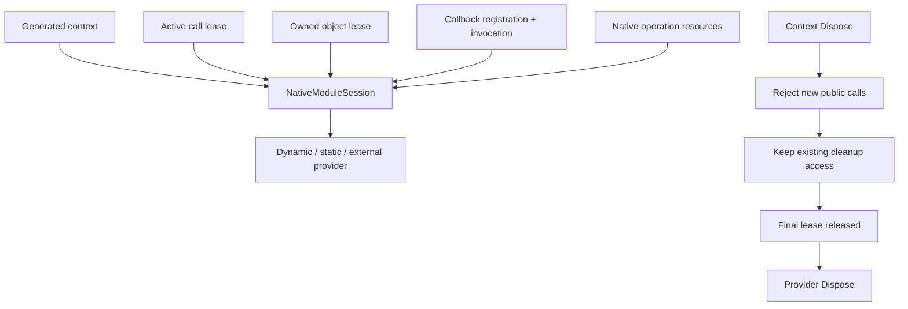

# Runtime lifetimes

[Documentation](README.md) · [简体中文](runtime-lifetime.cn.md) · [ABI safety](abi-safety.md)

`BGCS.Runtime` supports native invocation without a generator or parser
dependency. Its resource mechanisms do not infer a library's ownership,
unregister protocol or asynchronous completion. Those facts must come from
the native API's declared contract.

## Module sessions and leases

A session starts with one context reference. `AcquireCall()` retains the module
for a public call; `AcquireResource()` retains it for a native resource.
Closing the context releases its reference and refuses new public calls.
An existing resource's `AcquireCleanupCall()` can still protect destruction
after context closure. Ordinary resource operations remain forbidden after
closure. The provider is disposed only when the final reference drains.

`NativeModuleSession.Dispose()` initiates closure without waiting for owned
resources. `DisposeAsync()` also waits for final release and reports provider
unload failures. Release owned objects/registrations before awaiting the session,
otherwise the wait depends on leases that the caller still holds. Captured
`unloadFailure` is not evidence that unload succeeded.

A session roots its provider during construction so that GC cannot queue a
custom provider's finalizer before the session can close it. Acquiring the first
native resource lease upgrades that preallocated root to the session. Releasing
the last successful resource while the context remains open restores its target
to the provider; the session itself can then finalize normally. A custom
provider must not retain its owning session if abandoned-session finalization
is required: that cycle keeps the session reachable, so explicit `Dispose()` is
required. Closing with outstanding leases or attempting provider unload also
retains the session. An
ambiguous resource or provider cleanup failure keeps the session and its
provider rooted even when user objects become unreachable. This prevents a
custom provider's `SafeHandle` finalizer from bypassing the outstanding lease.
The session does not root owned handles, so their normal finalizers can still
release native resources. Successful provider unload releases the root; an
ambiguous terminal failure intentionally retains the module until process
exit, without automatically retrying an operation that might have completed.
Known terminal resource cleanup failure faults pending or later
`DisposeAsync()` immediately while retaining the provider; it does not leave an
`await using` chain waiting forever for a release that cannot safely be retried.

## Providers and complete function tables

The final lease's releasing thread calls provider `Dispose()` synchronously;
abandoned contexts can reach this boundary on the finalizer thread. A custom
provider must support that thread or require explicit draining on its supported
thread. The session does not apply an allocator's thread domain to module
unload. Returning means the provider's declared cleanup completed; throwing
retains the provider and faults session completion without retry.

### Explicitly shared static APIs

`api.style = "static"` emits a public static facade such as `WidgetApi` and a
separate instance type `WidgetApiContext`. The default instance style retains
its ordinary independent context. Static friendly methods forward through the
same planned instance conversions, native calls and cleanup.

Initialize the facade with `Load(path)` or `FromProvider(provider)` for a
dynamic FunctionTable, `Create()` for runtime imports, or the supported
`FromStatic()` adapter factory. Facade factories return `void` and own the
shared context. The concrete context factories still return independent
disposable instances. Calls before initialization fail.

A candidate must resolve every required export and pass storage guards before
an atomic replacement installs it. Failure retains the previous context.
Replacement closes that previous instance. A concurrent operation that has not
acquired its old call lease can receive `ObjectDisposedException`; admitted
calls retain their module until completion. Old owned objects keep their
original cleanup leases and can be destroyed, while ordinary calls on them
are refused after closure.

`Raw` captures the instance selected by that property read; a saved raw object
does not switch libraries later. `IsInitialized` observes shared state and is
not a synchronization lock. `Dispose()` clears and closes the current context.
`DisposeAsync()` clears, closes and waits for the current instance it captured.
Release that instance's owned resources before awaiting its closure. Earlier
replaced or cleared instances finish cleanup through their own retained leases.

Use multiple `WidgetApiContext` instances when independent lifetimes or precise
control of concurrent library selection are needed. They do not participate in
facade state. Owned wrapper types belong to the concrete context, for example
`WidgetApiContext.WidgetObject`.

| Provider | Ownership |
| --- | --- |
| `DynamicModuleProvider` | Owns its native-library handle and releases it once. |
| `StaticModuleProvider` | Copies names/addresses; optional explicit release action, otherwise borrowed static exports. |
| `ExternalFunctionTableProvider` | Copies a validated ordered table and takes a supplied lifetime lease only after successful validation. |
| Custom `INativeModuleProvider` | Implements exact symbol lookup and its own release contract. |

Generated dynamic factories use the consumer assembly for native asset and
AssemblyLoadContext resolution. This is not `SetDllImportResolver` interception.
Custom loaders use the explicit provider factory.

Required symbols resolve as a complete immutable set; a missing or zero address
fails initialization before a partial table is exposed. External tables check
matching ABI identity strings, exact extent, unique names and nonzero addresses.
An identity assertion cannot independently prove ABI compatibility. A table
producer must keep every address valid until its transferred lifetime ends.

The [custom function-table example](../examples/CustomFunctionTable/README.md)
adapts an external seven-slot protocol with reserved entries and a different
callable order. Its consumer references only Runtime, validates the producer's
original extent and ABI identity, and supplies the selected names and addresses
to `FromProvider`. The actual generated consumer test calls functions that are
not native exports, refuses invalid and incomplete tables, and verifies that
closing a context retains its module reference until an active native call
returns from a reverse callback. Slot selection belongs to the explicit
consumer adapter; it does not require another generator configuration format.

## Owned and borrowed handles

`OwnedNativeHandle` retains a module lease and matching release action/domain.
`Invoke(...)` protects both SafeHandle storage and the module against concurrent
disposal. `AsBorrowed()` returns a view that follows its owner; it does not gain
destruction responsibility and cannot outlive owner validity.

Release uses a cleanup lease, so destruction remains possible after context
closure. Successful destruction releases the resource's module lease.
The SafeHandle finalizer path captures failures in `releaseFailure` rather
than throwing. Failed destruction retains the module; it is not silently
treated as success and SafeHandle does not provide an automatic retry protocol.
Native allocators, deallocators and thread-release domains must agree.

Generated owning wrappers require explicitly supported ownership/release facts.
A raw pointer or a suggestive Create/Destroy name does not establish ownership.

`ModuleBorrowedNativeHandle` is a separate Runtime primitive for an explicitly
module-lifetime borrowed address. It adopts one `NativeModuleLease` and never
calls a native destructor or free operation. `Invoke(...)` protects both the
reference and module for a synchronous call. Context closure rejects new calls;
already started calls finish before reference disposal can release the lease.
Disposal and the SafeHandle finalizer release only that lease. Module-provider
unload failures remain observable through `NativeModuleSession.unloadFailure`
and `DisposeAsync()`.

The native protocol must independently guarantee that the address stays valid
until actual module unload. A retained library cannot preserve an unrelated
object that native code destroys or replaces earlier. Zero creates an invalid
reference and immediately releases the adopted lease; a null lease fails before
adoption. The source feature `handles.module-borrowed` selects this same Runtime
implementation and its dependency closure.

The generator supports this protocol through `semantics.borrowedResults` with an
explicit `"lifetime": "module"`. This remains a `UserAsserted` address-validity
guarantee. `api.memberFunctions[].kind = "moduleBorrowed"` selects a typed wrapper
with the same exact native record or opaque alias identity. Each receiver still
needs an explicit borrowed, nonretaining `call` parameter contract. Disposal
releases only the module lease; the wrapper has no native destructor, allocator
domain or owning `AsBorrowed()` operation. Aliases, function containers and finite
default arguments forward to the same checked operation. A null getter result is
reported as an error; use `Raw` to inspect a library-specific null-result protocol.

The initial typed protocol covers direct synchronous pointer getters and
scalar/void members. Owner-bound, call-bound and mutable-global references need
their own validity protocol. Conflicting release declarations, removed native
`const`/`volatile` qualifiers, cross-context arguments and unsupported inputs are
rejected or leave only the raw operation. Closing the context rejects new calls;
an already started call retains the module until it returns.

Generated ABI storage structs are `partial`, so consumer files can add methods
without editing generated output. Added instance storage must still satisfy the
recorded layout; partial declarations do not grant new native ABI permission.

## Callback registrations

`CallbackRegistration` owns a nonzero static thunk or explicitly retained
callback pointer, optional retained state and module lease. The generic
`CallbackRegistration<TDelegate>` retains a delegate where supported.

The native unregister action must prevent new callback starts before returning
and synchronize native work that would otherwise outlive the retained module.
Each thunk enters with `TryEnterInvocation(...)` and releases its invocation
lease in a `finally` block. The default `CallbackShutdownOrder.CloseBeforeUnregister`
rejects new entries when closure is requested. Explicit `KeepOpenUntilUnregistered`
keeps legitimate callbacks admitted during native stop-and-join, then closes
admission after successful acknowledgement. Failed unregister retains admission,
state and the module for retry. Final cleanup always waits for successful
unregister and all entered invocations. `isClosing` reports the shutdown request,
not whether the selected policy currently admits a callback.

`CallbackRegistry<TState>` roots state for static AOT thunks behind nonzero,
non-reused user-data tokens. `TryGet` rejects retired tokens without dereferencing
a freed `GCHandle`. Retire a token registration only after native stop-and-join.
Token lookup cannot protect a freed native proxy or vtable: destroying a virtual
proxy requires quiescence of the entire native execution frame, beyond managed
thunk return.

Self-disposal defers unregister outside the callback thread so a native stop/join
can wait for its return. A failed unregister retains resources and records
`closeFailure`; a later disposal can retry. Await `DisposeAsync()` **outside**
an active invocation of that registration. A callback awaiting its own drain
creates a dependency cycle. In browser/single-thread environments prefer an
asynchronous protocol that does not block work needed for completion.

`CallbackExceptionBoundary` captures managed exceptions and returns an explicit
fallback, with a bounded per-instance queue. Reverse native calls must not allow
managed exceptions to cross the unmanaged boundary. AOT uses static thunks;
dynamic delegate support is not assumed universal.

Runtime registration support and raw callback ABI support are separate from
automatic generated retained-callback/event projection. Current generated
coverage must be read from the feature inventory and concrete receipts.
The generator does not infer arbitrary native unregister guarantees.

### Generated C++ virtual registrations

`bridge.cpp.virtualCallbacks` explicitly selects an abstract interface. Its default
`releaseThreadDomain = "unknown"` preserves checked raw construction, destruction,
base adjustment and callback typedefs, while reporting why an owning managed
registration is omitted. Explicit `"any"` is a caller assertion and remains
`UserAsserted`, never `Verified`.

Selection ID `calculator` adds `ICalculatorCallbacks`,
`CalculatorCallbackRegistration`, `CreateCalculatorCallbacks(target, stopAndJoinNative)`
and `WithCalculatorCallbacks(target, operation)` to the concrete context. A shared
facade forwards to the same implementation. Static AOT thunks use exact Cdecl
arguments and result pointers. Checked scalar/Boolean conversions are supported;
native references and object addresses remain borrowed `nint` values.

The required `Action<nint>` must prevent and join **all native execution using
the interface** before returning. Registration `Invoke` retains the module and
proxy and coordinates with shutdown. `DangerousGetNativeInterface` borrows an
address whose external uses must follow that same protocol. Context closure
refuses new public `Invoke` calls while existing callbacks retain cleanup access.
Successful stop-and-join plus managed invocation drain precede destruction.
Failed stop retains state/module and exposes retryable `closeFailure`. The stop
action also needs a cleanup domain usable after context closure; ordinary raw
calls on a closed context are not automatically admitted.

`WithCalculatorCallbacks` asserts one synchronous nonretaining operation: all
native execution must end before its operation returns. Returning an incomplete
Task does not satisfy that contract. Self-disposal defers stop/destruction until
the current native call can return.

Managed exceptions are captured by `TakeCallbackException()`. Nonzero callback
status causes the native proxy to throw a C++ exception, caught by BGCS export
boundaries and converted to the native error channel. Foreign native worker
threads calling the interface directly must catch that C++ exception or use an
explicit native fallback adapter. Nonthrowing interfaces do not use this policy.
Six Windows CoreCLR import/runtime rows exercise these mechanisms; corresponding
generated registrations on other platforms and NativeAOT need independent gates.

## Native asynchronous operations

`NativeOperation<TResult>` owns a copied sequence of lifetimes such as a pin,
callback registration, handle or module lease. The first terminal
`TrySetResult`, `TrySetException` or `TrySetCanceled` wins. It releases
lifetimes in reverse order before settling `task`; cleanup failure faults the
task, and multiple terminal signals cannot release twice.

`Dispose()` requests native cancellation and keeps resources alive.
`DisposeAsync()` requests cancellation and awaits terminal acknowledgement.
Cancellation requested is **not** proof that native code stopped accessing
buffers. The native completion protocol must call a terminal method only after
resource access ends. If no terminal acknowledgement arrives, waiting cannot
manufacture one. This Runtime mechanism does not imply arbitrary generated
C APIs automatically expose Task-based wrappers.

## Strings, buffers and alignment

Temporary friendly strings use strict UTF-8/UTF-16/UTF-32 codecs and a
`NativeStringLease` for explicitly nonretaining calls. Null allowance,
termination, code-unit width/order and lifetime must match the native contract.
The lease ends after the call. Native-owned returned text needs its own
allocator/release protocol.

Pinned span conversion requires explicit synchronous call lifetime, bounds,
direction, null allowance and nonretention. Native code cannot retain a pointer
after the fixed region. Separate capacity protocols and asynchronous retention
are not inferred as safe spans.

`NativeAlignedBuffer` owns matched aligned allocation/free and requires a
power-of-two alignment at least as strict as pointer alignment. Its address is
borrowed until disposal; callers must synchronize concurrent use. Correctly
aligned memory still does not prove by-value calling ABI.

## Custom allocation and matching release

`NativeAllocator` retains the actual allocation and free callbacks together with
an immutable `allocatorId`, a required `NativeAllocatorThreadDomain` and an
optional module session. A string identifying a release domain does not supply
these callbacks. `Allocate(logicalLength, alignment)` checks a positive power of
two, rounds a nonzero physical extent with overflow checks, and verifies the
returned address. Its `NativeBuffer` permanently keeps the matching free pair
and passes that same physical extent and alignment back to native code.

`buffer.Invoke((address, logicalLength) => ...)` protects storage against
concurrent disposal and retains a call lease when a module is supplied. Closing
that module stops new allocation and public buffer operations; existing storage
still retains the module for its matching cleanup. Native allocator context
state can belong to the module provider's final release callback, so it is
destroyed only after all allocations have been freed. Callers must not retain
the borrowed address past an invocation without another explicit lifetime.

`AnyThread` is an explicit assertion that both callbacks safely support
arbitrary concurrent threads, including finalization. `Dispatcher` requires an
`INativeReleaseDispatcher`: allocation and access must satisfy `CheckAccess`,
and off-thread disposal queues cleanup through `Post`. The dispatcher must
retain and eventually execute the action on an allowed thread. `Dispose`
stops new buffer use immediately; `DisposeAsync` waits for in-flight use and
the actual matching free. Keep an affine dispatcher alive and pumping until
that operation completes; no finalizer waits synchronously for it.

A release exception is ambiguous because native free may have already
completed. `releaseFailure` records it, `DisposeAsync` faults, and the module
lease remains retained. Runtime never automatically retries that arbitrary
free or treats the failure as success. A recoverable native release needs its
own explicit state protocol. Missing dispatcher execution likewise cannot be
converted into proof that storage was released.

The [custom allocator example](../examples/CustomAllocator/README.md) uses a
real per-instance native allocator, rejects wrong owner/extent pairs, compares
a native checksum, and closes the context while a buffer remains alive.
The source feature `memory.native-allocator` selects the same implementation
through `RuntimeSourceCatalog`. This consumer allocation abstraction does not
silently replace the temporary string allocator or implement every generated
per-parameter allocation protocol.

The strict input codecs also accept an explicit allocator overload:
`Utf8Codec.EncodeNullTerminated(text, allowsNull, alignment, allocator)` and
`Utf16Codec`/`Utf32Codec.EncodeNullTerminated(text, allowsNull, bigEndian, alignment, allocator)`.
Omitting the allocator keeps the framework allocation behavior. Text validation
precedes allocation; the resulting `NativeStringLease` retains the actual pair
and module through matching cleanup. `Dispose()` closes access and reports a
known immediate cleanup failure. `DisposeAsync()` additionally waits for the
actual affine free and faults on an ambiguous release; finalization never
throws or blocks for a dispatcher. A borrowed `pointer` requires the caller to
keep the lease alive and coordinate disposal until the native call returns.
The codec source features include this same allocator dependency closure.

Generated contexts containing text inputs expose an optional
`temporaryAllocatorFactory` on their ordinary `Load`, `FromProvider`, `Create`
or `FromStatic` factory. The callback receives that instance's exact
`NativeModuleSession`; return a `NativeAllocator` constructed with the same
session. A null result or a different/unbound session fails initialization and
closes the candidate. The callback runs only after the complete import table
and storage guards succeed. The immutable selected allocator serves temporary
friendly text conversions; omitting it preserves framework allocation.
An explicitly shared facade forwards the same factory to its owned context.
Capture independently checked native allocation/free addresses in callbacks;
cleanup must remain callable after context closure, so calling the closed
context's ordinary `api.Raw` is unsuitable. Keep native allocator state valid
until all corresponding buffers and text leases finish cleanup.

## Explicit C ownership and receiver presentation

A direct C pointer factory can use `semantics.ownedResults` to declare its exact
release function, allocation/release domain and `releaseThreadDomain: "any"`.
The implemented automatic path requires a synchronous pointer return and an
exact `void(T*)` release with no conflicting parameter protocol. It retains a
module resource lease before calling the factory, rejects a null result, and
cleans any acquired pointer if installing its owned handle fails. Unsupported
ownership conveniences retain the checked raw ABI and report
`BGCS-FRIENDLY-OMITTED`; an integer handle or a status-returning destructor
needs an explicit supported adapter. These configuration assertions remain
`UserAsserted` rather than becoming independent native verification.

`api.memberFunctions` separately selects an exact C function, receiver parameter
and native record or named opaque-pointer alias. The receiver also requires an
explicit `semantics.borrowedParameters` contract with `lifetime: "call"` and
`retainsPointer: false`. Presentation never changes a free function into an
invented C++ member. A matching supported factory produces the named owned
object. Its methods invoke through the handle's call/resource lifetime, and a
typed context facade rejects objects from another context. An optional
`releaseDomain` on a member additionally restricts it to the declared native
allocation/release domain. Two unrelated aliases of `void*` do not establish a
shared object identity. Raw calls remain available for deliberately managed
native protocols.

Aliases, function views, default arguments and an explicitly shared static API
forward the same checked context signatures. Context disposal prevents new
ordinary object calls; matching object destruction remains callable until its
resource lease drains. This does not make a native object thread-safe or prove
its application-level synchronization protocol.

## Package/source delivery and acceptance

`runtime.mode = "package"` references Runtime.
`runtime.mode = "source"` selects a source closure in the API-local namespace;
single-file output can include it. Both modes use the same supported resource
semantics. Source presence does not add generator dependencies to consumers.

Runtime tests cover module drain, concurrent handle access, callback unregister
failure/retry/self-close, exception boundaries, cancellation/terminal races,
strict text and allocation. Independent NativeAOT/browser fixtures additionally
invoke native callbacks, objects and table failure paths. These are distinct
from any broader platform certification. Generated call-scoped callbacks and
returned-handle and callback/user-data registrations use the same Runtime protocols; explicit terminal
operations add memory pins and a separate full native join before settling their
task. The synchronous join projection requires a runtime that permits blocking
native cleanup. See the [callback cookbook](callbacks.md) for exact contracts and
the current supported factory shapes.
See [testing](testing.md), [ABI safety](abi-safety.md) and the
[feature inventory](../eng/acceptance/feature-inventory.json). Certification
records the exact target/runtime/import and source revision.

## Explicit native module ownership

`DynamicModuleProvider.FromHandle(handle, ownsHandle: true)` adopts one
already-loaded platform module reference after successful construction.
`ownsHandle: false` borrows it; the external owner must keep the module loaded
until all provider/session uses finish. Zero handles are rejected before
ownership can transfer. Provider lookup is serialized with disposal. A resolved
address does not retain the module; use a session call lease or equivalent native
lifetime synchronization while invoking it.

Name/path resolution and custom export lookup can be composed separately for
each provider passed to the generated `FromProvider` factory. Process-global
loader interception is unnecessary. Empty static exports use
`new StaticModuleProvider([])`.

Required function tables are frozen only after every required symbol resolves.
Changing their layout creates a new complete provider. This preserves running
calls and avoids installing partially initialized or zero callable slots.
Native tables with reserved slots use the
[Runtime-only slot adapter](../examples/CustomFunctionTable/README.md), which
copies checked required addresses and retains the supplied module lifetime.

## Copying direct native string results

`semantics.stringResults` combines an explicit UTF-8/UTF-16/UTF-32 extent with a
separate owned or module-borrowed return contract. The wrapper keeps one call lease
through native return, strict decoding and matching owned cleanup. Owned results use
the exact independent `void(T*)` release in `finally`, including invalid Unicode,
null-contract, length and conversion failures; temporary input allocation cleanup
retains its own allocator pair. Module-borrowed results are copied before that call
lease ends and never receive an invented native release.

The codecs expose `Decode(address, maximumCodeUnits, ...)` for zero-terminated
storage and `DecodeLength(address, codeUnitCount, ...)` for exact extents. Both copy
strict Unicode; exact extents preserve embedded nulls. A scalar volatile code-unit
scan stops at the first terminator before forming a span, so a large scan cap does
not cause a vector read into a following guard page. Native code still must guarantee
valid memory through its terminator or exact length. No managed bounds check proves
an arbitrary native pointer readable. See the [configuration guide](configuration-guide.md#explicit-direct-string-results).
